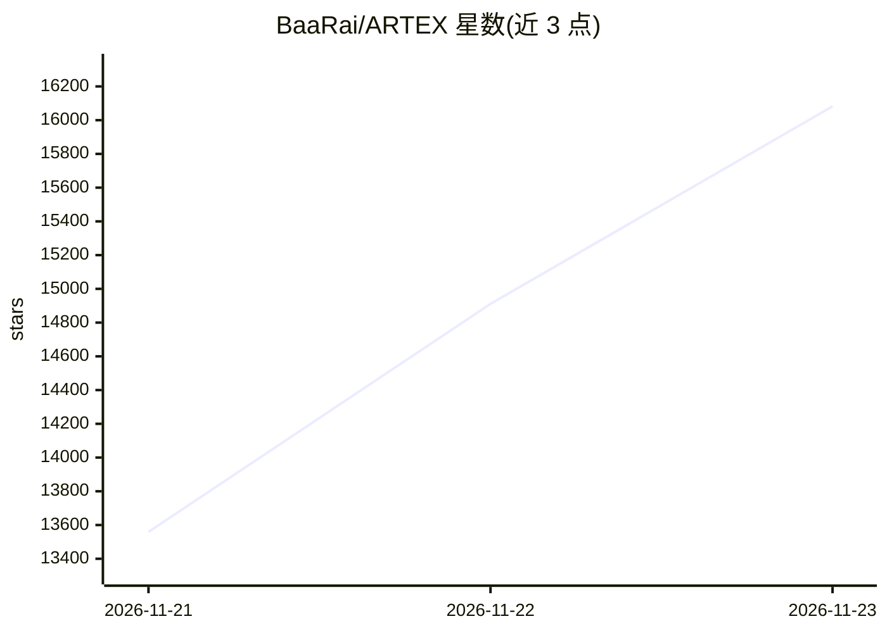

# BaaRai/ARTEX

⭐ 16,082 · Go · AGPL-3.0 · 推送 2026-11-22 · [GitHub](https://github.com/BaaRai/ARTEX) · 个人维护

**自托管多智能体自主渗透测试平台，产出带证据的发现**

用 Go 编写的自托管 LLM 驱动渗透测试平台，单个 Go 二进制内嵌 Next.js UI，依赖 PostgreSQL。规划器将目标拆解为意图，工作器调用真实工具执行并回写两个关联图（资产图与探索图），形成事件驱动的推进循环。每条发现绑定捕获的 HTTP 请求/响应作为证据，支持 MITM 代理与浏览器扩展采集流量、漏洞复测循环、报告导出。自治行为受审批门、scope 规则、token/轮次预算和噪声调控器约束。

## 筛选速览

| 维度 | 判定 | 备注 |
|---|---|---|
| AI 角色 | `ai-native` | 本体是模型或模型工具 |
| 许可风险 | `viral` | AGPL-3.0 |
| 部署形态 | `self-host` | docker 或自建部署 |
| 模型依赖 | local-ok | 支持本地模型 |
| 硬件要求 | — | 无带数字的原话,不猜 |
| 安装摩擦 | `low` | 无编译、无系统依赖或容器化 |
| 成熟度 | — | 结构信号不足 |

## 能力要点

- 双图架构：共享资产图与每任务探索图通过锚点关联
- MITM 代理与浏览器扩展采集流量，发现绑定请求/响应证据
- 人工审批门、argv 前缀规则、scope/deny 门与任务/意图预算
- 支持 MCP 服务器、技能与远程工具扩展 agent

## 适用场景

- 对授权目标执行自主渗透测试并保留可审计证据链
- 赏金项目中按范围管理资产测试覆盖
- 对已报告漏洞做固定版本条件下的复测

## 场景标签

`多智能体` `网络安全` · 领域:Agent 开发

## 证据(README 行号)

> L9: Self-hosted multi-agent offensive security. A planner explores, workers run real tools,
> L19: ARTEX is a self-hosted, LLM-driven penetration testing platform. It is not a chat wrapper around
> L33: - **Self-hosted and model-agnostic.** One Go binary with the Next.js UI embedded, PostgreSQL,

## 星数曲线

2026-11-21 13,559 → 2026-11-23 16,082（+2,523）

---
*卡片 v1 · prompt 1.4 · 生成 2026-11-23 · 置信度 high · 依据 README sha `92bcf80b3a60` · [字段定义](../../DATASET.md)*
