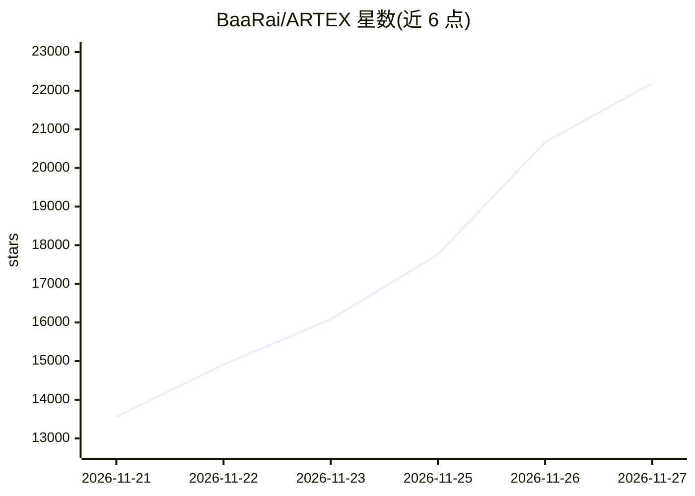

# BaaRai/ARTEX

⭐ 22,190 · Go · AGPL-3.0 · 推送 2026-11-26 · [GitHub](https://github.com/BaaRai/ARTEX) · 个人维护

**自托管的多智能体自动化渗透测试平台，产出带证据的发现**

ARTEX 是一个自托管的 LLM 驱动渗透测试平台：规划器（planner）将目标分解为意图（intents），工作器（workers）调用真实工具执行，结果写回资产图与探索图两张关联图。每个发现可绑定捕获的 HTTP 请求/响应证据，所有自主动作经过范围规则、审批门与预算控制。通过 MITM 代理与浏览器扩展捕获流量，发现可复测并生成报告。以单个 Go 二进制 + PostgreSQL 提供，通过 docker compose 部署。

## 筛选速览

| 维度 | 判定 | 备注 |
|---|---|---|
| AI 角色 | `ai-native` | 本体是模型或模型工具 |
| 许可风险 | `viral` | AGPL-3.0 |
| 部署形态 | `self-host` | docker 或自建部署 |
| 模型依赖 | local-ok | 支持本地模型 |
| 硬件要求 | — | 无带数字的原话,不猜 |
| 安装摩擦 | `low` | 无编译、无系统依赖或容器化 |
| 成熟度 | — | 结构信号不足 |

## 能力要点

- 双图架构：共享资产图 + 每任务探索图，锚点关联
- MITM 代理与浏览器扩展捕获流量，发现绑定请求/响应证据
- 拦截门、范围/拒绝门、token 与轮次预算、噪声调控器等控制机制
- 多 LLM 配置轮换与故障转移，支持 Anthropic/OpenAI 兼容端点与本地 Ollama

## 适用场景

- 对授权范围内的目标执行自动化渗透测试并保留完整证据链
- 漏洞复测：retester 代理重跑发现并记录可复现/已修复状态
- 资产图共享与 ScopeSentry 资产同步，覆盖团队多任务场景
- 通过 MCP 服务器、技能与记忆扩展 agent 工具能力

## 场景标签

`多智能体` `网络安全` · 领域:Agent 开发

## 证据(README 行号)

> L20: ARTEX is a self-hosted, LLM-driven penetration testing platform. It is not a chat wrapper around
> L34: - **Self-hosted and model-agnostic.** One Go binary with the Next.js UI embedded, PostgreSQL,

## 星数曲线

2026-11-21 13,559 → 2026-11-27 22,190（+8,631）

---
*卡片 v1 · prompt 1.4 · 生成 2026-11-27 · 置信度 high · 依据 README sha `10f50d6a25f3` · [字段定义](../../DATASET.md)*
