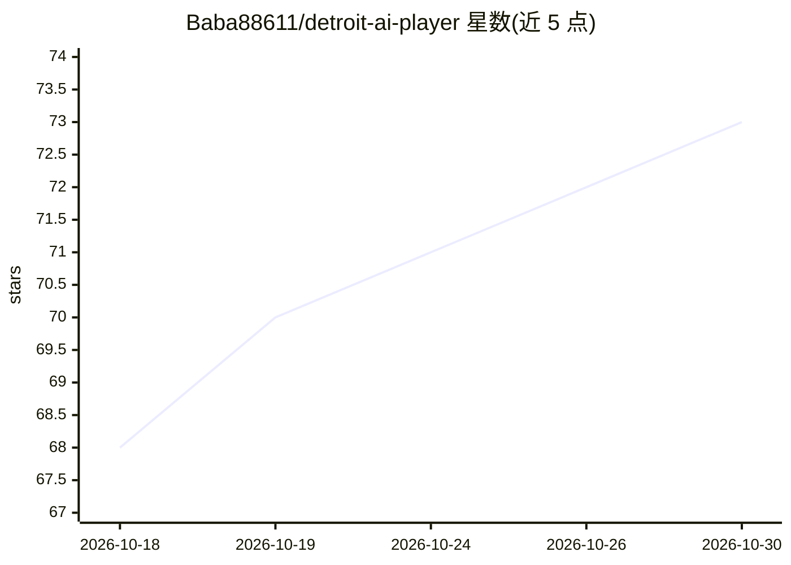

# Baba88611/detroit-ai-player

⭐ 73 · Python · MIT · 推送 2026-10-08 · [GitHub](https://github.com/Baba88611/detroit-ai-player) · [官网](https://github.com/Baba88611/detroit-ai-player) · 个人维护 · 中文 README

**让 LLM 自主游玩《底特律：变人》剧情决策树的实验框架**

将《底特律：变人》32 章分支剧情改写为决策树 JSON（中英双语独立撰写），由 runner 逐节点调用 AI 做选择，观察不同模型、人格设定与重复运行下的道德决策差异。采用两层信息隔离架构：被测 AI 只见叙事与选项（player_facing 层），概率与状态变量仅由 runner 使用（system 层），模型上下文不包含攻略信息。支持 OpenAI 兼容 API（DeepSeek/OpenAI/GLM/本地模型）、原生 Anthropic 端点、TypeSafe 专用后端，以及 claude-code / codex-cli（实验性）Agent CLI 后端，后者无需 API key。代码 MIT 许可，剧情数据 CC BY-NC 4.0，为非商业研究项目，不含游戏素材。

## 筛选速览

| 维度 | 判定 | 备注 |
|---|---|---|
| AI 角色 | `ai-ecosystem` | LLM/agent 周边工具 |
| 许可风险 | `permissive` | MIT |
| 部署形态 | `library` | 以包/库形式分发 |
| 模型依赖 | — | README 未给出锁定关系 |
| 硬件要求 | — | 无带数字的原话,不猜 |
| 安装摩擦 | `low` | 无编译、无系统依赖或容器化 |
| 成熟度 | `idea` | |

## 能力要点

- 32 章中英双语决策树 JSON（原创改写，非游戏原文）
- player_facing/system 两层信息隔离，模型上下文不含后果提示
- 可切换模型、persona 系统提示、语言与难度（QTE 概率）的实验变量
- claude-code / codex-cli Agent CLI 后端可用订阅会话免 API key 运行

## 适用场景

- 比较不同 LLM 在相同道德困境下的选择差异
- 用不同 persona 提示测量同一模型的行为漂移
- 重复运行同一配置检验 AI 决策稳定性

## 场景标签

`模型评测` · 领域:评测与运维

## 证据(README 行号)

> L10: > Turn a branching narrative into structured decision-tree data, then let **your AI**
> L51: This repository does not include the author's experimental conclusions. It provides
> L62: Run the same configuration multiple times to examine stability, compare models to

## 星数曲线

2026-10-18 68 → 2026-10-30 73（+5）

---
*卡片 v1 · prompt 1.4 · 生成 2026-10-24 · 置信度 mid · 依据 README sha `1dc112d953a6` · [字段定义](../../DATASET.md)*
