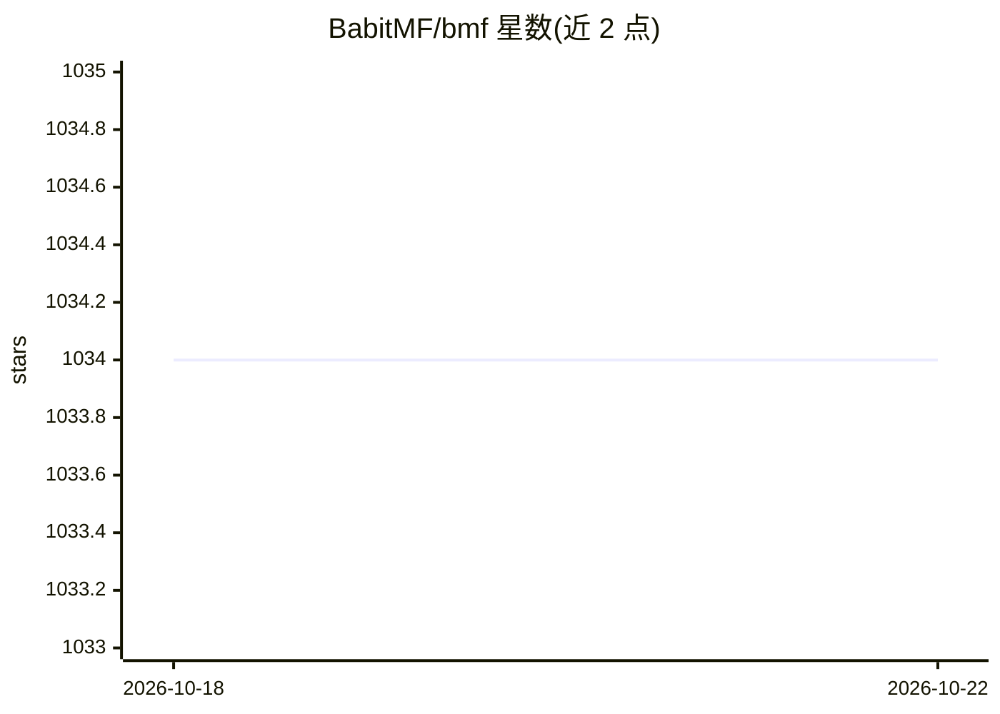

# BabitMF/bmf

⭐ 1,035 · C++ · Apache-2.0 · 推送 2026-08-26 · [GitHub](https://github.com/BabitMF/bmf) · [官网](https://babitmf.github.io/) · 组织维护 · 中文 README

**字节跳动开源的跨平台多媒体处理框架，支持 AI 推理集成**

BMF（Babit Multimedia Framework）是字节跳动开发的跨平台多媒体处理框架，覆盖视频转码、音视频编辑、直播推流、GPU 加速与 AI 推理集成等场景，提供 Python/Go/C++ API，支持 Linux/Windows/macOS 及 x86/ARM CPU。框架支持 CPU/GPU 异构流水线，可在 FFmpeg/Numpy/PyTorch/OpenCV/TensorRT 间转换数据格式，并可将 DeOldify、Real-ESRGAN、TensorRT 人脸检测等算法封装为处理模块。各能力演示提供 Google Colab 环境。客户端另有轻量版 BMFLite。

## 筛选速览

| 维度 | 判定 | 备注 |
|---|---|---|
| AI 角色 | `ai-enhanced` | 去掉 AI 部分产品仍成立 |
| 许可风险 | `permissive` | Apache-2.0 |
| 部署形态 | `None` |  |
| 模型依赖 | — | README 未给出锁定关系 |
| 硬件要求 | — | 无带数字的原话,不猜 |
| 安装摩擦 | `medium` | 含编译或系统依赖之一 |
| 成熟度 | — | 结构信号不足 |

## 能力要点

- 提供 Python/Go/C++ 三种语言 API，跨 Linux/Windows/macOS
- 支持 CPU/GPU 异构流水线与 FFmpeg/Numpy/PyTorch/OpenCV/TensorRT 数据格式转换
- 可将 AI 算法（DeOldify、Real-ESRGAN、TensorRT 人脸检测等）封装为流水线模块
- 提供视频转码、编辑、直播广播、LLM 预处理等 Colab 演示

## 适用场景

- 搭建视频转码或音视频编辑流水线
- 在视频处理链路中集成超分、上色、人脸检测等 AI 推理模块
- 构建多路视频拉流、混音与 RTMP 推流的广播服务
- 为 LLM 训练数据做视频切分、字幕检测与质量评估预处理

## 场景标签

`图像视频处理` · 领域:感知与多模态

## 证据(README 行号)

> L3: **BMF (Babit Multimedia Framework)** is a cross-platform, multi-language, customizable multimedia processing framewo
> L24: In this section, we will directly showcase the capabilities of the BMF framework around six dimensions: **Transcode
> L83: This demo shows how to integrate the state of art AI algorithms into the BMF video processing pipeline. The famous 

## 星数曲线

2026-10-18 1,034 → 2026-10-22 1,034（+0）

---
*卡片 v1 · prompt 1.4 · 生成 2026-10-21 · 置信度 high · 依据 README sha `c0294f75a2e8` · [字段定义](../../DATASET.md)*
