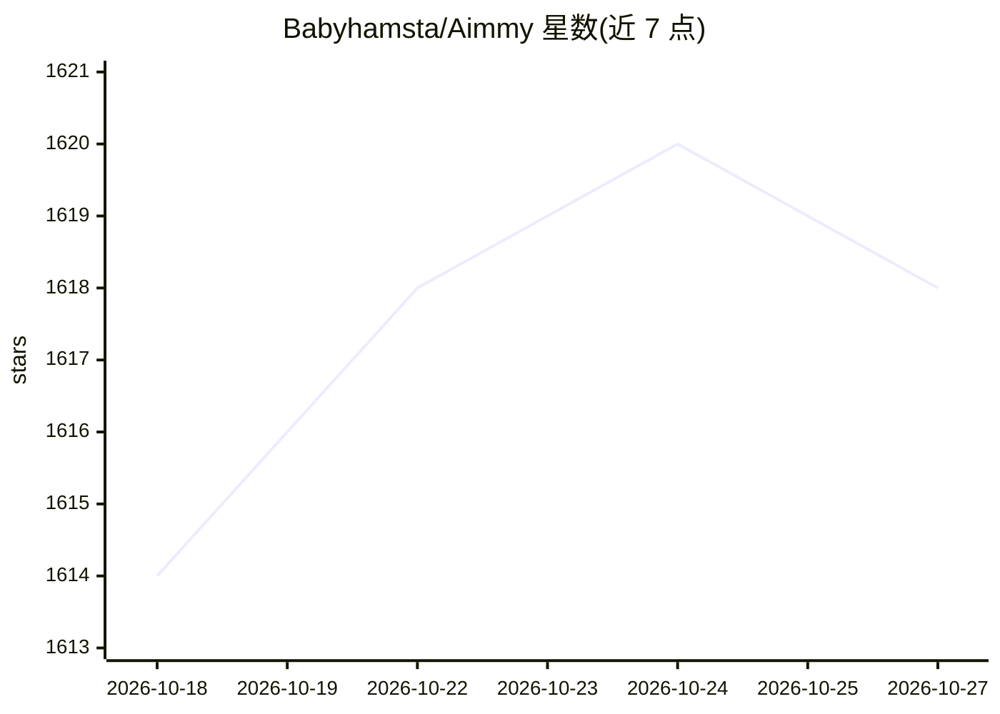

# Babyhamsta/Aimmy

⭐ 1,618 · C# · NOASSERTION · 推送 2026-10-04 · [GitHub](https://github.com/Babyhamsta/Aimmy) · 组织维护

**面向操作受限玩家的 C# AI 瞄准辅助桌面工具（YOLOv8 屏幕检测）**

由 BabyHamsta、MarsQQ 与 Taylor 开发的 Windows 桌面程序，用 C#/.NET 8/WPF 编写，通过屏幕截图配合 DirectML+ONNX+YOLOv8 模型检测游戏画面中的玩家，结合 X/Y 轴调整、FOV 设置与 5 种鼠标移动方式改变光标位置，按键触发即生效。面向有肢体、视觉或协调障碍的玩家。提供图形界面、ESP 高亮、模型/配置商店与热切换；自带预训练模型，可训练自有模型并上传。项目声明为 source-available 而非开源，禁止商用分支，需安装 .NET Runtime 8 与 VC++ 运行库后解压运行。

## 筛选速览

| 维度 | 判定 | 备注 |
|---|---|---|
| AI 角色 | `ai-native` | 本体是模型或模型工具 |
| 许可风险 | `none` | NOASSERTION |
| 部署形态 | `desktop` | 安装包/桌面程序 |
| 模型依赖 | — | README 未给出锁定关系 |
| 硬件要求 | — | 无带数字的原话,不猜 |
| 安装摩擦 | `medium` | 含编译或系统依赖之一 |
| 成熟度 | — | 结构信号不足 |

## 能力要点

- DirectML+ONNX+YOLOv8 屏幕检测，支持 AMD/NVIDIA GPU
- 内置 UI、ESP 高亮、模型与配置商店及热切换
- 5 种鼠标移动方式，可在界面内调整置信度与 FOV
- 预置训练模型，并提供自有模型训练与上传教程

## 适用场景

- 手部协调或视觉受限玩家在 FPS 游戏中获得瞄准辅助
- 按游戏定制模型与配置并从商店获取社区模型
- 训练并分享针对特定游戏的 YOLOv8 检测模型

## 场景标签

`目标检测` · 领域:感知与多模态

## 证据(README 行号)

> L7: Aimmy is a universal AI-Based Aim Alignment Mechanism developed by BabyHamsta, MarsQQ & Taylor to make gaming more a
> L42: When you press the trigger binding, Aimmy will capture the screen and run the image through AI recognition powered 
> L47: 2. DirectML + ONNX + YOLOv8 AI Detection Algorithm

## 星数曲线

2026-10-18 1,614 → 2026-10-27 1,618（+4）

---
*卡片 v1 · prompt 1.4 · 生成 2026-10-21 · 置信度 high · 依据 README sha `370bee8e1b2f` · [字段定义](../../DATASET.md)*
