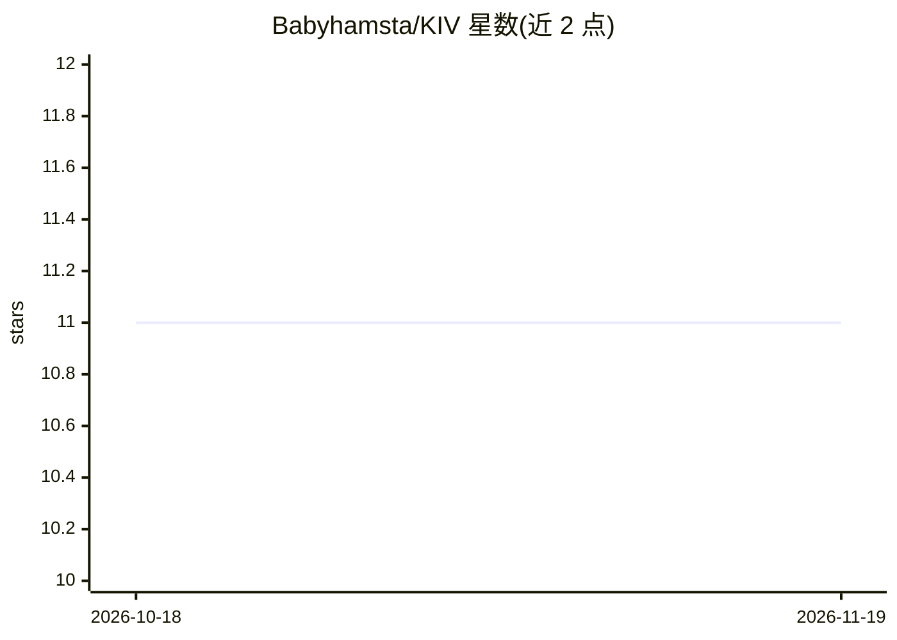

# Babyhamsta/KIV

⭐ 11 · Python · Apache-2.0 · 推送 2026-04-23 · [GitHub](https://github.com/Babyhamsta/KIV) · 个人维护

**KV cache 中间件：12GB 显存本地跑 1M token 长上下文**

以 HuggingFace cache 替换层形式运行的 KV cache 中间件：仅保留最近约 2K token 的完整 K/V 在 VRAM，用 K 向量页摘要（每 128 token 均值）做检索索引，解码时按需从系统 RAM 取回高分页的 V 向量；不改模型权重、不需重训，卸载干净。提供 Python 中间件与兼容 ollama HTTP API 的服务端（绑定 11434 端口），Open WebUI、Continue、Cline、LangChain 等客户端可直接指向使用。基准显示 1M 上下文时 VRAM 缓存恒为 12 MB，解码约 4.1 tok/s；生成请求串行执行，面向单用户单 GPU。

## 筛选速览

| 维度 | 判定 | 备注 |
|---|---|---|
| AI 角色 | `ai-ecosystem` | LLM/agent 周边工具 |
| 许可风险 | `permissive` | Apache-2.0 |
| 部署形态 | `desktop` | 安装包/桌面程序 |
| 模型依赖 | local-ok | 支持本地模型 |
| 硬件要求 | `gpu-8g` | |
| 安装摩擦 | `low` | 无编译、无系统依赖或容器化 |
| 成熟度 | — | 结构信号不足 |

## 能力要点

- K 向量作索引、按需取回 V 的分层 hot/cold cache 机制，无模型改动
- 兼容 ollama HTTP API 的服务端，Open WebUI/Continue/Cline/LangChain 可直接接入
- 1M token 下 VRAM 缓存恒定 12 MB，70/70 needle-in-haystack 测试通过
- 多槽位 KV cache 池支持 append 复用与 LRU 驱逐

## 适用场景

- 在 12GB 消费级 GPU 上本地运行超长上下文对话
- 把 50 万 token 文档粘贴进 Open WebUI 做长文问答
- 为已有 ollama 客户端工作流替换后端以扩展上下文窗口

## 场景标签

`推理引擎` · 领域:训练与推理

## 证据(README 行号)

> L3: Run a local LLM with a conversation history **250× longer** than your GPU should allow. KIV keeps only the last ~2K 
> L95: KIV replaces the KV cache for global attention layers with a page-based tiered system. The model's own attention co

## 星数曲线

2026-10-18 11 → 2026-11-19 11（+0）

---
*卡片 v1 · prompt 1.4 · 生成 2026-11-19 · 置信度 high · 依据 README sha `9bfe3517307a` · [字段定义](../../DATASET.md)*
