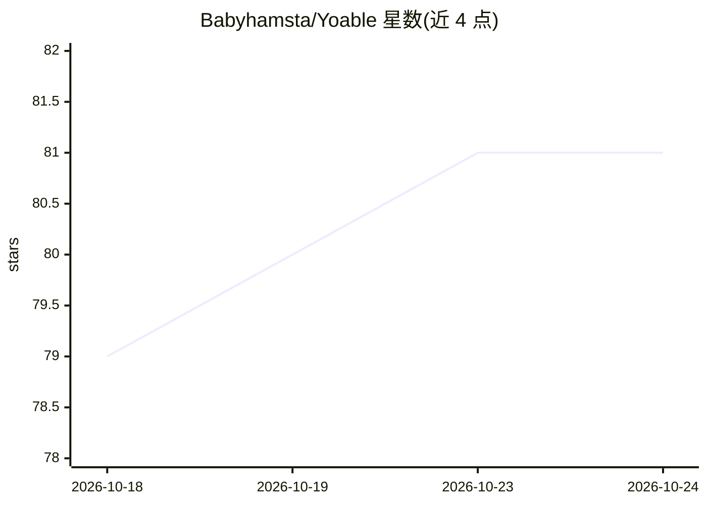

# Babyhamsta/Yoable

⭐ 81 · C# · 推送 2026-03-17 · [GitHub](https://github.com/Babyhamsta/Yoable) · 个人维护 · 中文 README

**带 AI 自动标注的 YOLO 图像标注桌面工具**

C# 开源图像标注工具，面向制作 YOLO 数据集的用户：支持手动绘制/编辑边界框，可加载 YOLO v5/v8/v11（ONNX）模型进行 AI 自动检测标注；另有标签传播建议（图像相似度、物体相似度、帧间跟踪三种模式）、模型类别 ID 映射与过滤、类别筛选、可自定义快捷键与项目保存。标注以 YOLO 格式导入导出，导出时可选择上传数据集。界面支持英/日/俄/简中/繁中五种语言即时切换。Windows 免安装可直接运行，另提供非 WPF 旧版分支。

## 筛选速览

| 维度 | 判定 | 备注 |
|---|---|---|
| AI 角色 | `ai-enhanced` | 去掉 AI 部分产品仍成立 |
| 许可风险 | `none` | — |
| 部署形态 | `None` |  |
| 模型依赖 | — | README 未给出锁定关系 |
| 硬件要求 | — | 无带数字的原话,不猜 |
| 安装摩擦 | `low` | 无编译、无系统依赖或容器化 |
| 成熟度 | — | 结构信号不足 |

## 能力要点

- 加载 YOLO v5/v8/v11（ONNX）模型做 AI 自动检测标注
- 标签传播建议：图像相似度/物体相似度/跟踪三模式，可逐条或批量接受
- 模型类别 ID 映射，可设 nan 过滤类别
- YOLO 格式标注导入导出，五种界面语言即时切换

## 适用场景

- 为 YOLO 训练快速制作边界框数据集
- 用预训练模型自动标注再人工校对，减少手工量
- 对视频帧序列用跟踪模式传播标签

## 场景标签

`目标检测` · 领域:感知与多模态

## 证据(README 行号)

> L5: **Yoable** is an AI-powered image annotation tool designed to make dataset labeling faster and more efficient. It su
> L20: - **Manual Labeling Tools** - Easily add, edit, and remove bounding boxes.
> L44: - **Manual Labeling**: Use the drawing tools to create bounding boxes.

## 星数曲线

2026-10-18 79 → 2026-10-24 81（+2）

---
*卡片 v1 · prompt 1.4 · 生成 2026-10-24 · 置信度 high · 依据 README sha `b1fe1313ecc1` · [字段定义](../../DATASET.md)*
