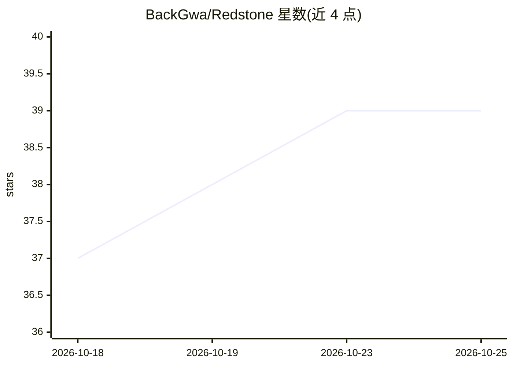

# BackGwa/Redstone

⭐ 39 · TypeScript · MIT · 推送 2026-05-11 · [GitHub](https://github.com/BackGwa/Redstone) · [官网](https://www.npmjs.com/package/opencode-redstone) · 个人维护

**面向 Minecraft 插件开发的 Opencode 多智能体系统**

基于 Opencode 的 AI agent 系统，用于自动化 Minecraft 插件开发流程。由 7 个专职 agent（编排、文档、计划、项目初始化、代码探索、API 检索等）组成，通过 npm 全局安装并需预装 Opencode；插件构建依赖 JDK（与目标 Minecraft 版本匹配）与 Gradle，Kotlin 项目另需 Kotlin。提供三种模式：Balanced（部分 agent 用默认免费模型）、Professional（选用 Codex/Claude 等闭源模型）、Manual（逐 agent 指定模型 ID）。

## 筛选速览

| 维度 | 判定 | 备注 |
|---|---|---|
| AI 角色 | `ai-native` | 本体是模型或模型工具 |
| 许可风险 | `permissive` | MIT |
| 部署形态 | `library` | 以包/库形式分发 |
| 模型依赖 | — | README 未给出锁定关系 |
| 硬件要求 | — | 无带数字的原话,不猜 |
| 安装摩擦 | `low` | 无编译、无系统依赖或容器化 |
| 成熟度 | — | 结构信号不足 |

## 能力要点

- 7 个专职 agent 分工：编排/文档/计划/项目初始化/探索/API 检索
- 三种模式配置模型（Balanced/Professional/Manual）
- npm 全局安装，交互式 installer 引导
- 支持按目标 Minecraft 版本匹配 JDK 的 Gradle 构建流程

## 适用场景

- 让 agent 生成和初始化 Minecraft 插件项目
- 探索既有代码库并检索插件 API 文档与依赖
- 逐步实现插件功能并维护实现计划与项目文档

## 场景标签

`多智能体` `编码 Agent` · 领域:Agent 开发

## 证据(README 行号)

> L3: Redstone is an AI agent system based on Opencode that automates and simplifies the entire Minecraft plugin developme
> L64: ## Agent Architecture

## 星数曲线

2026-10-18 37 → 2026-10-25 39（+2）

---
*卡片 v1 · prompt 1.4 · 生成 2026-10-25 · 置信度 high · 依据 README sha `888915aa8f74` · [字段定义](../../DATASET.md)*
