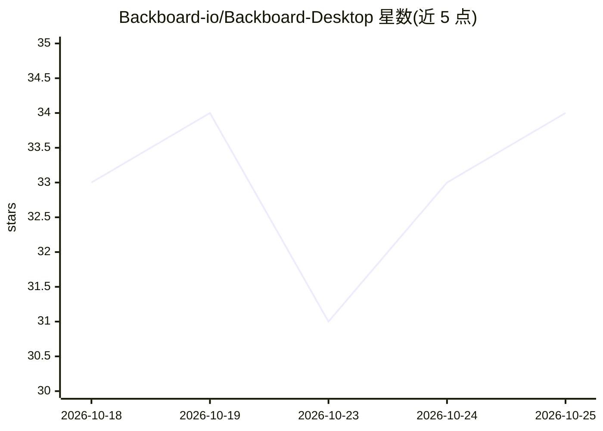

# Backboard-io/Backboard-Desktop

⭐ 34 · TypeScript · NOASSERTION · 推送 2026-10-25 · [GitHub](https://github.com/Backboard-io/Backboard-Desktop) · 组织维护

**基于 Code - OSS 的桌面 AI 编码 agent IDE，聚合多家模型**

MIT 许可的桌面 AI agent 工作台，构建于 Code - OSS（VS Code 开源核心）之上，支持 macOS/Windows/Linux。提供自主编码 agent（读改运行代码、diff 审查面板、检查点回滚）、并行 agent 会话（隔离 git worktree）、浏览器与桌面操作（computer use）、AI 图像与视频生成。模型接入支持 BYOS（Claude Pro/Max、ChatGPT 订阅）、BYOK（OpenAI/Anthropic/Google/xAI/OpenRouter，存于 OS keychain）及 Backboard 托管模型。需从源码构建运行。

## 筛选速览

| 维度 | 判定 | 备注 |
|---|---|---|
| AI 角色 | `ai-native` | 本体是模型或模型工具 |
| 许可风险 | `permissive` | NOASSERTION |
| 部署形态 | `None` |  |
| 模型依赖 | locked-api |  |
| 硬件要求 | — | 无带数字的原话,不猜 |
| 安装摩擦 | `medium` | 含编译或系统依赖之一 |
| 成熟度 | — | 结构信号不足 |

## 能力要点

- 自主编码 agent，带 diff 审查面板与可回滚检查点
- 并行 agent 会话，按项目/分支隔离 git worktree
- computer use：agent 可操作浏览器与桌面应用
- BYOS/BYOK：使用 Claude 或 ChatGPT 订阅，或自有 API key（OS keychain 加密存储）

## 适用场景

- 在单一桌面 IDE 中运行自主编码 agent 并审查其改动
- 用现有 Claude/ChatGPT 订阅跑 agent，避免重复付费
- 并行运行多个 agent 会话分别处理不同分支任务
- 让 agent 操作浏览器和桌面应用完成端到端任务

## 场景标签

`编码 Agent` `GUI 自动化` `浏览器自动化` `视频生成` · 领域:效率与自动化

## 证据(README 行号)

> L5: Backboard Desktop is a free, MIT-licensed AI agent workspace for macOS, Windows, and Linux. Run autonomous coding ag
> L39: - **AI coding agents:** agents read, write, and run code in your project, with checkpoints you can rewind and a rev
> L44: - **Computer use and browser use:** agents can operate a browser and desktop apps to finish tasks end to end.

## 星数曲线

2026-10-18 33 → 2026-10-25 34（+1）

---
*卡片 v1 · prompt 1.4 · 生成 2026-10-25 · 置信度 high · 依据 README sha `f3d03271a0ed` · [字段定义](../../DATASET.md)*
