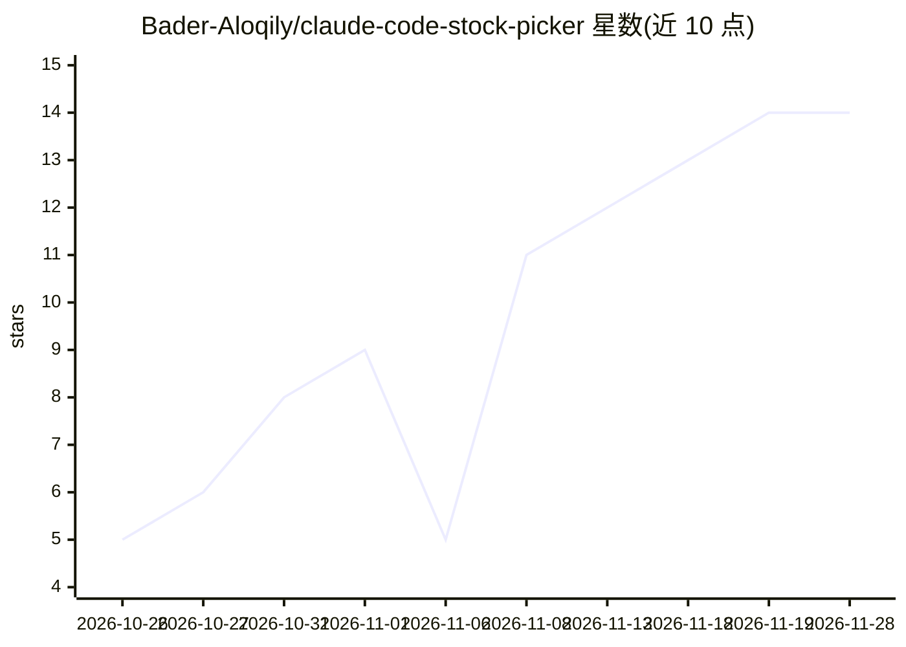

# Bader-Aloqily/claude-code-stock-picker

⭐ 14 · Python · MIT · 推送 2026-10-19 · [GitHub](https://github.com/Bader-Aloqily/claude-code-stock-picker) · 个人维护

**在 Claude Code 内运行的每周美股 AI 选股命令系统**

以 Claude Code 斜杠命令形式分发的选股系统：10 个专职 agent 并行扫描约 5,000–7,000 只美股，经硬过滤与 100 分评分模型（催化剂 40 分、期权流 18 分等）产出最多 5 个候选；周五按周一开盘到周五收盘的市场排名（前 500/100 为 WIN/BIG WIN）对照约 13% 随机基线与种子随机对照组自我评级，并执行记录在案的 Decision Review；配置按规则 F1 冻结至第 12 个评级周。README 作者注明截至归档记录该系统在其自设标准上尚未证明优势。需 macOS/Linux、Python 3 与含 stocks REST + S3 flat files 的 Polygon.io 方案。

## 筛选速览

| 维度 | 判定 | 备注 |
|---|---|---|
| AI 角色 | `ai-native` | 本体是模型或模型工具 |
| 许可风险 | `permissive` | MIT |
| 部署形态 | `None` |  |
| 模型依赖 | locked-api |  |
| 硬件要求 | — | 无带数字的原话,不猜 |
| 安装摩擦 | `low` | 无编译、无系统依赖或容器化 |
| 成熟度 | — | 结构信号不足 |

## 能力要点

- 10 个 Claude agent 全市场扫描（约 5–7k 美股）与 100 分评分模型
- 对照约 13% 基线与种子随机-5 对照组的周度自我评级
- 预注册通过线与决策评审（evidence bar E1–E10）的证据驱动修改机制
- Sharia 六类业务黑名单过滤与 stdlib-only 漂移 linter

## 适用场景

- 每周日跑 /us-picks 获取至多 5 个美股研究候选
- 周五收盘后按市场排名对自己选股系统做客观评级
- 以透明 Markdown/Python 形式 fork 并定制自己的选股流程

## 场景标签

`多智能体` `金融量化` · 领域:Agent 开发

## 证据(README 行号)

> L7: **An open-source AI stock picker that runs inside Claude Code.** Ten specialised Claude agents scan every US stock e
> L16: This is the system I run my own money on, as of tag `v6.3-author`. The repo ships the complete `/us-picks` slash co

## 星数曲线

2026-10-26 5 → 2026-11-28 14（+9）

---
*卡片 v1 · prompt 1.4 · 生成 2026-11-18 · 置信度 high · 依据 README sha `1f4d3943d68d` · [字段定义](../../DATASET.md)*
