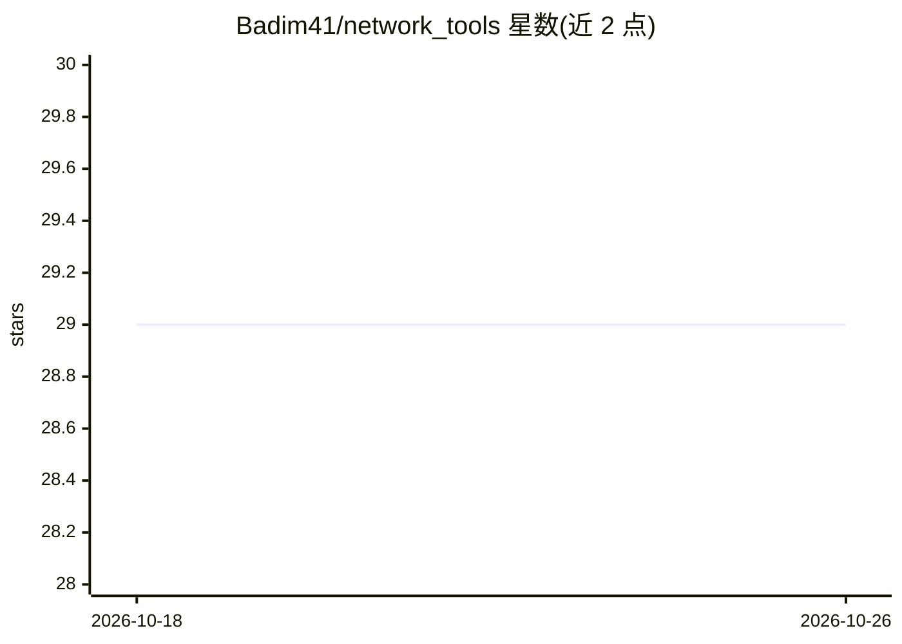

# Badim41/network_tools

⭐ 29 · Jupyter Notebook · 推送 2026-10-22 · [GitHub](https://github.com/Badim41/network_tools) · 个人维护

**多模型付费 API 聚合服务的 Python 客户端库**

封装 yellowfire.ru API 端点的 Python 同步/异步客户端：提供文本对话（GPT、Claude、Gemini、DeepSeek、Grok、Command 等）、图像生成与编辑（Flux、Recraft V3、Nano Banana 2）、视频生成（Kling 3）、音乐（Suno）、TTS（Gemini TTS 16 音色）、音频生成（Stable Audio）与语音识别接口，支持 OpenAI 格式 function calling 与 /v1/chat/completions 兼容端点。API key 通过 Telegram 机器人获取，附送 1 Credit（100₽）免费额度；按 token/张/条计费，价格表列于 README。部分模型标注暂时不可用，文档为俄语。

## 筛选速览

| 维度 | 判定 | 备注 |
|---|---|---|
| AI 角色 | `ai-ecosystem` | LLM/agent 周边工具 |
| 许可风险 | `none` | — |
| 部署形态 | `library` | 以包/库形式分发 |
| 模型依赖 | locked-api |  |
| 硬件要求 | — | 无带数字的原话,不猜 |
| 安装摩擦 | `low` | 无编译、无系统依赖或容器化 |
| 成熟度 | — | 结构信号不足 |

## 能力要点

- 覆盖文本/图像/视频/音乐/TTS/音频/STT 七类生成与识别接口
- 提供同步与异步客户端，以及 OpenAI /v1 兼容端点与 curl 示例
- 支持 Function Calling（OpenAI/MCP tools 格式）与多格式文件上传（txt/docx/pdf/图片）
- 图像编辑含去背景、inpaint、upscale、矢量化和图生 3D 模型

## 适用场景

- 在 Python 项目中调用多家厂商的文本与多模态模型
- 搭建带 function calling 的对话或 agent 应用
- 统一接入图像生成、视频、音乐与语音合成/识别功能

## 场景标签

`模型网关` · 领域:Agent 开发

## 证据(README 行号)

> L6: **OpenAI endpoint: `https://sert.yellowfire.ru:444/v1`** (самый стабильный) / `https://ru.yellowfire.ru/v1` (RU (нес
> L97: ```python
> L117: Поддерживается передача `tools` в формате OpenAI / MCP (как через `NetworkToolsAPI`, так и через `/v1/chat/complet

## 星数曲线



2026-10-18 29 → 2026-10-26 29（+0）


---
*卡片 v1 · prompt 1.4 · 生成 2026-10-26 · 置信度 low · 依据 README sha `731b2b3cb05f` · [字段定义](../../DATASET.md)*
