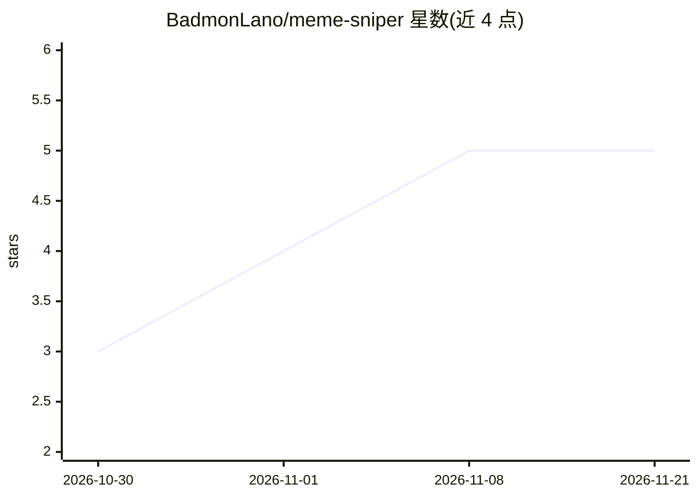

# BadmonLano/meme-sniper

⭐ 5 · Python · MIT · 推送 2026-11-19 · [GitHub](https://github.com/BadmonLano/meme-sniper) · [官网](https://bentaygaempirellc.com) · 个人维护

**给 SI agent 用的 Solana memecoin 扫描与交易建议机器人**

Python 编写的 Solana memecoin 交易机器人，由用户的 SI agent（读写文件并运行 Python 的 AI agent）驱动：sniper 进程扫描新代币、做 rug 检查，把候选写入 JSON inbox，agent 写回买卖信号，机器人执行并带止损/止盈/追踪止损管理。默认纸面模拟与建议模式，实盘签名、armed stops、launch rail（带 GitHub 仓库门控的发币通道）均需显式开启。内置日亏损上限、买入次数上限、流动性门槛等安全设置。

## 筛选速览

| 维度 | 判定 | 备注 |
|---|---|---|
| AI 角色 | `ai-native` | 本体是模型或模型工具 |
| 许可风险 | `permissive` | MIT |
| 部署形态 | `desktop` | 安装包/桌面程序 |
| 模型依赖 | local-ok | 支持本地模型 |
| 硬件要求 | — | 无带数字的原话,不猜 |
| 安装摩擦 | `low` | 无编译、无系统依赖或容器化 |
| 成熟度 | — | 结构信号不足 |

## 能力要点

- 扫描新 Solana 代币并做多源 rug 检查，以 JSON packet 写入 agent inbox
- 默认 paper 模式与 suggest 模式：缺省环境变量时不签名
- launch rail 带 dev-buy 上限与 GitHub 公共仓库门控，默认关闭
- 内置日亏停买、连败暂停、流动性下限、信号复核等风控开关

## 适用场景

- 让本地或托管的 SI agent 读 inbox 并提出买卖建议，人工审批后执行
- 用 paper 模式以真实报价做无签名模拟交易
- 通过带仓库门控的通道发行自己的代币（需显式开启）

## 场景标签

`金融量化` · 领域:学习与行业

## 证据(README 行号)

> L7: Your agent's trench crew. Meme Sniper scans every new Solana memecoin and rug-checks it. Trade ideas are suggestions
> L36: Around those: an SI "brain" (Grok, OpenAI, Claude, any OpenAI-compatible endpoint, or local Ollama), alerts to your
> L42: - **SI agent:** your AI agent (hosted or local) that reads packets, decides and writes signals. Sniper executes and

## 星数曲线

2026-10-30 3 → 2026-11-21 5（+2）

---
*卡片 v1 · prompt 1.4 · 生成 2026-11-21 · 置信度 mid · 依据 README sha `a6389797b6de` · [字段定义](../../DATASET.md)*
