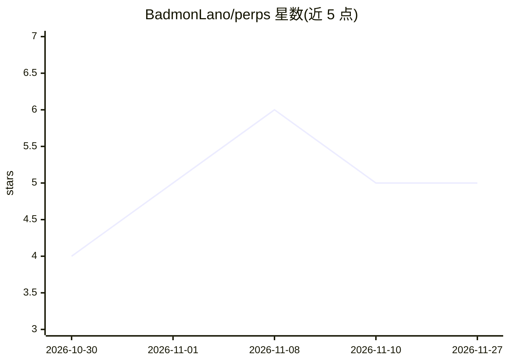

# BadmonLano/perps

⭐ 5 · Python · MIT · 推送 2026-10-29 · [GitHub](https://github.com/BadmonLano/perps) · [官网](https://bentaygaempirellc.com) · 个人维护

**让 AI agent 在主人规则内管理 Jupiter 永续合约的 Solana 交易机器人**

面向 Jupiter Perps（SOL/BTC/ETH）的 Solana 永续合约执行系统：机器人读取价格、资金费、持仓与三条外部行情，生成 JSON packet 写入 inbox，由用户的 SI agent 借助 skills/ 决策并回写 signal 文件；机器人执行硬门槛检查（杠杆区间、抵押上限、实时价格）后成交或拒绝。默认纸面模式（PERPS_DRY_RUN=true）模拟成交，不签名不上链。机器人自身不做决策，也不自动平仓。可选 Grok 或本地 Ollama 作摘要用 brain，关闭后交易流程不变。

## 筛选速览

| 维度 | 判定 | 备注 |
|---|---|---|
| AI 角色 | `ai-enhanced` | 去掉 AI 部分产品仍成立 |
| 许可风险 | `permissive` | MIT |
| 部署形态 | `library` | 以包/库形式分发 |
| 模型依赖 | local-ok | 支持本地模型 |
| 硬件要求 | — | 无带数字的原话,不猜 |
| 安装摩擦 | `low` | 无编译、无系统依赖或容器化 |
| 成熟度 | — | 结构信号不足 |

## 能力要点

- packet→signal→gate 的文件交接执行架构，机器人永不自行决策或开仓
- 默认纸面模式按 Pyth 实时预言机价模拟成交，无需钱包与密钥
- 硬门槛校验每条信号，越界请求拒绝而非缩放
- 持续运行循环：活跃时段、节奏与各 lane 周期均可配置

## 适用场景

- 让常驻 SI agent 在自设规则内代理管理永续仓位
- 先在纸面模式验证交易策略再切换实盘
- 设置止损/止盈/移动止损与清算预警监控持仓

## 场景标签

`金融量化` · 领域:学习与行业

## 证据(README 行号)

> L7: Perps is a Solana perpetuals trading system for Jupiter Perps (SOL, BTC, ETH) that an **SI agent runs on behalf of a
> L63: - **Optional SI brain:** Grok or local Ollama for summaries; trading works the same with it off.
> L33: Perps can be run by Grok Bot, Muse, or an agent from any of the larger SI companies: any SI agent that can read and

## 星数曲线

2026-10-30 4 → 2026-11-27 5（+1）

---
*卡片 v1 · prompt 1.4 · 生成 2026-11-21 · 置信度 low · 依据 README sha `3241c606e38d` · [字段定义](../../DATASET.md)*
