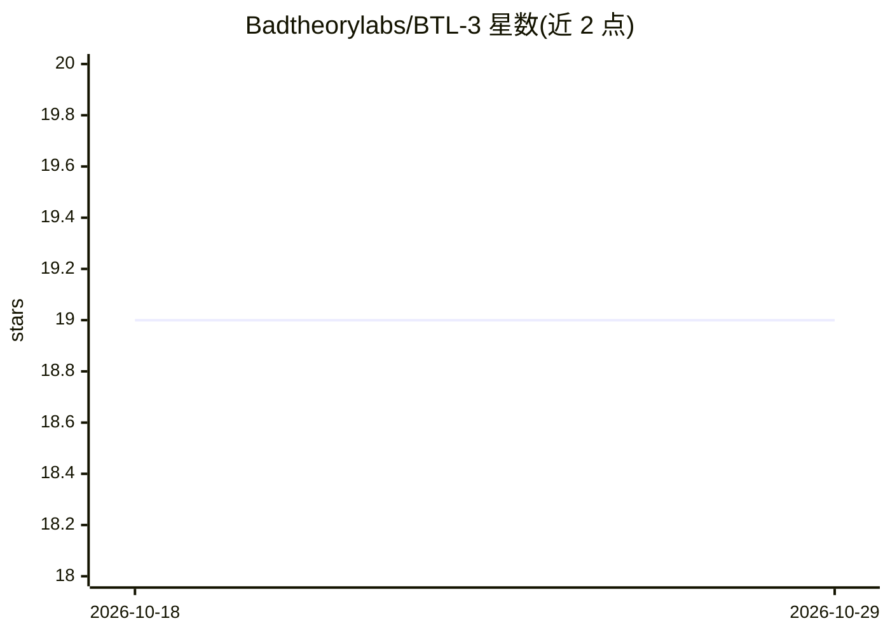

# Badtheorylabs/BTL-3

⭐ 19 · C++ · MIT · 推送 2026-07-24 · [GitHub](https://github.com/Badtheorylabs/BTL-3) · 组织维护

**Bad Theory Labs 的 27B 编码与工具调用模型及原生本地推理运行时**

BTL-3 是基于 Qwen3.6-27B 的 27B 编码与工具调用模型（RL-0013 冻结检查点，rank-32 PEFT 适配器，Apache-2.0），面向仓库代理场景：结构化单/多/并行工具调用、失败后多轮恢复、显式弃权行为。Compact 版为 8.39 GB 独立 GGUF，配套定制的 packed llama.cpp 原生运行时（MIT），在 macOS Metal 与 NVIDIA CUDA 上验证，提供 OpenAI-compatible 服务端、Ollama CLI 桥与 LM Studio 生成器（开发预览）。thinking 模式默认禁用且不推荐使用。

## 筛选速览

| 维度 | 判定 | 备注 |
|---|---|---|
| AI 角色 | `ai-native` | 本体是模型或模型工具 |
| 许可风险 | `permissive` | MIT |
| 部署形态 | `library` | 以包/库形式分发 |
| 模型依赖 | local-ok | 支持本地模型 |
| 硬件要求 | — | 无带数字的原话,不猜 |
| 安装摩擦 | `high` | 编译与系统依赖俱全 |
| 成熟度 | `idea` | |

## 能力要点

- 262,144 token 架构上下文，BFCL v4 AST 88.5%、HumanEval 95.12%
- Compact 版 8.39 GGUF 混合 AVQ2/INT4 量化，无需稠密重建，原生 Metal/CUDA 运行
- 打包运行时安装器逐文件校验哈希并原子安装
- OpenAI-compatible 服务端（流式、推理、工具、取消）

## 适用场景

- 私有/离线自托管运行编码与工具调用模型
- 构建仓库代理与终端 agent，执行结构化工具调用
- 在 Mac 与工作站上以单一 8.39 GB 制品本地推理

## 场景标签

`推理引擎` `模型量化` `编码 Agent` · 领域:编码与开发

## 证据(README 行号)

> L14: BTL-3 is Bad Theory Labs' 27B coding and tool-use model. It is built for
> L41: - Agentic coding and structured execution in the supported non-thinking mode.
> L240: |OpenAI-compatible server|**Verified**|Streaming, reasoning, tools, and cancellation|

## 星数曲线

2026-10-18 19 → 2026-10-29 19（+0）

---
*卡片 v1 · prompt 1.4 · 生成 2026-10-29 · 置信度 mid · 依据 README sha `8051a1182b62` · [字段定义](../../DATASET.md)*
