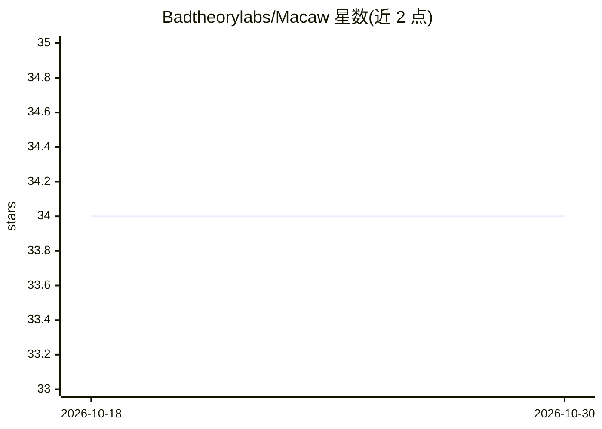

# Badtheorylabs/Macaw

⭐ 34 · Python · MIT · 推送 2026-08-08 · [GitHub](https://github.com/Badtheorylabs/Macaw) · 组织维护

**完全本地运行于 Mac 的 AI agent，97 个 macOS 工具自然语言操控**

Macaw 是基于 Liquid AI LFM2.5-2.6B 微调的 2.7B 模型及配套 macOS 应用的组合：模型经 MLX 4-bit 量化（约 1.5 GB）在 Apple Silicon 上本地运行，无云端、无账号。Swift 菜单栏应用通过 OpenAI 兼容接口调用模型，执行 97 个覆盖邮件、文件、日历、系统设置的已验证工具；安全机制为模型仅输出工具名与字面参数，AppleScript 由应用生成并按 tools.json 校验。需 macOS 14+、Python 3.10+，通过 pip 安装 mlx-lm 后 swift build 构建，另提供 CLI agent 循环。

## 筛选速览

| 维度 | 判定 | 备注 |
|---|---|---|
| AI 角色 | `ai-native` | 本体是模型或模型工具 |
| 许可风险 | `permissive` | MIT |
| 部署形态 | `library` | 以包/库形式分发 |
| 模型依赖 | — | README 未给出锁定关系 |
| 硬件要求 | — | 无带数字的原话,不猜 |
| 安装摩擦 | `low` | 无编译、无系统依赖或容器化 |
| 成熟度 | — | 结构信号不足 |

## 能力要点

- 97 个覆盖邮件/文件/日历/音乐/系统设置的 macOS 工具
- LFM2.5-2.6B 微调、MLX 4-bit 量化，Apple Silicon 全本地运行
- 安全机制：模型仅产出工具名与字面参数，脚本由应用侧生成校验
- 实测（M2 4-bit）：工具调用 10/10 准确、平均请求 1.21 s

## 适用场景

- 用自然语言在 Mac 上执行多步系统操作（邮件、文件、日历等）
- 无云端、无账号的本地 AI 助手替代方案
- 通过 CLI 运行多轮或自主 agent 循环

## 场景标签

`AI 助手` · 领域:对话与助手

## 证据(README 行号)

> L3: **Macaw is a private AI model that runs entirely on your Mac and controls it** — 97 verified tools for mail, files, 
> L9: - **Architecture:** fine-tune of Liquid AI LFM2.5-2.6B
> L18: python -m mlx_lm.server --model badtheorylabs/Macaw-4bit-MLX --port 8138

## 星数曲线

2026-10-18 34 → 2026-10-30 34（+0）

---
*卡片 v1 · prompt 1.4 · 生成 2026-10-25 · 置信度 high · 依据 README sha `a52f261cf690` · [字段定义](../../DATASET.md)*
