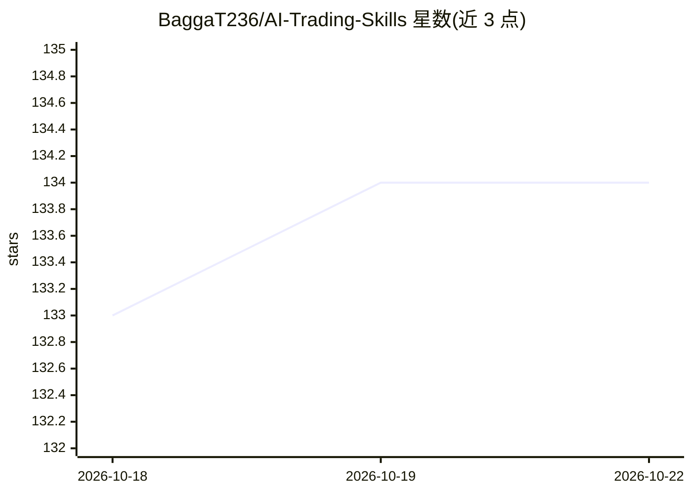

# BaggaT236/AI-Trading-Skills

⭐ 135 · Python · MIT · 推送 2026-09-14 · [GitHub](https://github.com/BaggaT236/AI-Trading-Skills) · 个人维护

**面向主观交易者的 TypeScript 交易工作流技能目录与 CLI**

提供严格类型的 TypeScript CLI，用于执行交易工作流与元数据校验；附技能目录覆盖市场状态分析、标的选择、仓位 sizing、复盘等环节；工作流以 YAML 编制的 playbook 组织，含明确决策门。状态缓存通过可选的 Redis 加速重复运行，无 Redis 也可运行。定位为辅助主观交易者改进流程质量，人类保留决策控制；声明仅供教育用途，非财务建议。

## 筛选速览

| 维度 | 判定 | 备注 |
|---|---|---|
| AI 角色 | `ai-ecosystem` | LLM/agent 周边工具 |
| 许可风险 | `permissive` | MIT |
| 部署形态 | `library` | 以包/库形式分发 |
| 模型依赖 | — | README 未给出锁定关系 |
| 硬件要求 | — | 无带数字的原话,不猜 |
| 安装摩擦 | `low` | 无编译、无系统依赖或容器化 |
| 成熟度 | — | 结构信号不足 |

## 能力要点

- TypeScript CLI 执行工作流并做元数据与索引校验
- YAML 驱动的 playbook 式工作流与决策门
- 可选 Redis 状态缓存，无 Redis 也能运行
- 预置每日市场状态、波段扫描、组合复盘等推荐工作流

## 适用场景

- 主观交易者按固定流程执行每日市场状态分析
- 组织标的选择、仓位与交易日志的复盘循环
- 为 Claude 类 agent 搭配交易分析技能

## 场景标签

`金融量化` `工作流自动化` · 领域:效率与自动化

## 证据(README 行号)

> L1: # Claude Trading Skills
> L7: - a large skill catalog for market analysis, screening, and review loops,
> L18: - **Workflow orchestration:** YAML-driven playbooks with clear decision gates.

## 星数曲线

2026-10-18 133 → 2026-10-22 134（+1）

---
*卡片 v1 · prompt 1.4 · 生成 2026-10-22 · 置信度 mid · 依据 README sha `48c8636c57d0` · [字段定义](../../DATASET.md)*
