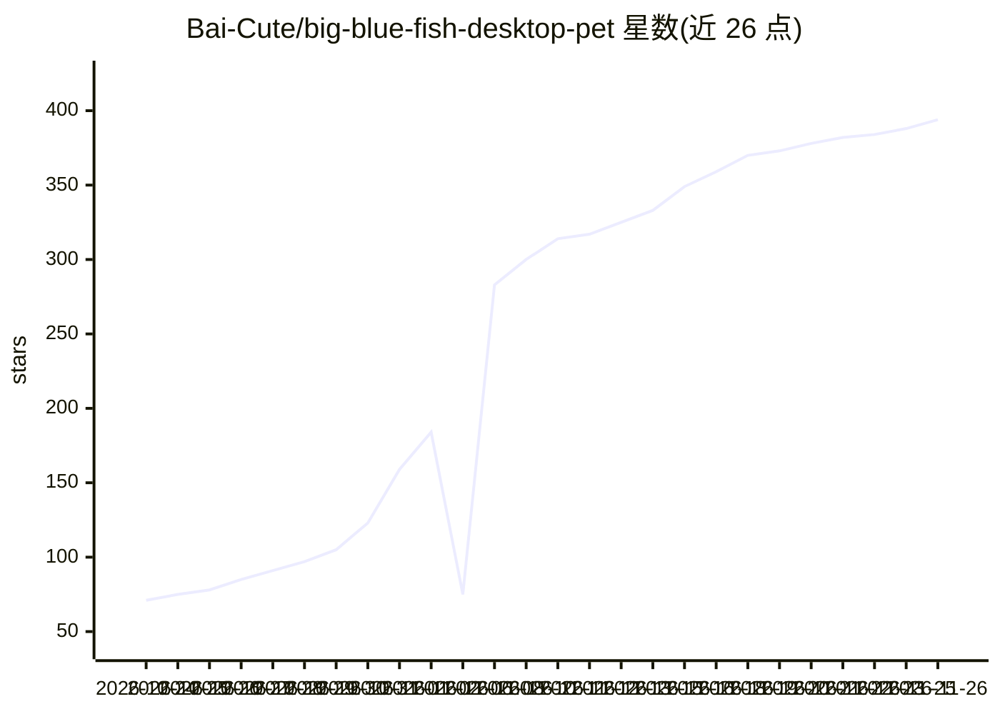

# Bai-Cute/big-blue-fish-desktop-pet

⭐ 394 · C# · Apache-2.0 · 推送 2026-11-25 · [GitHub](https://github.com/Bai-Cute/big-blue-fish-desktop-pet) · 个人维护 · 中文 README

**带 4B 本地大模型的鲸鱼娘 Windows/Linux/macOS 桌宠**

蓝色大肥鱼是一款桌面 AI 陪伴软件，形象为 DeepSeek 二创鲸鱼娘。读取前台窗口画面，经 OCR 识别文字后交给内置的 Qwen3.5-4B Q4_K_M GGUF 模型（llama.cpp 本地推理，支持 GPU/CPU），定时从文字气泡输出陪伴内容；播报天气（Open-Meteo）与 IT之家科技新闻。内置 106 段动画，覆盖节日、季节、饭点等场景。读屏内容仅本机使用，不上传云端。标准版可通过 ACP 连接 21 款 CLI Agent 进行长对话；无ACP版在编译期移除该功能。提供三平台安装包，支持应用内更新与离电暂停推理。

## 筛选速览

| 维度 | 判定 | 备注 |
|---|---|---|
| AI 角色 | `ai-native` | 本体是模型或模型工具 |
| 许可风险 | `permissive` | Apache-2.0 |
| 部署形态 | `desktop` | 安装包/桌面程序 |
| 模型依赖 | local-ok | 支持本地模型 |
| 硬件要求 | — | 无带数字的原话,不猜 |
| 安装摩擦 | `medium` | 含编译或系统依赖之一 |
| 成熟度 | — | 结构信号不足 |

## 能力要点

- 内置 Qwen3.5-4B Q4_K_M GGUF 模型，llama.cpp 本机推理，读屏不上传云端
- 读取前台窗口画面并按区域整理 OCR 文字后生成陪伴内容
- 标准版经 ACP 一键连接 21 款 CLI Agent，支持长对话与电脑操控
- 106 段动画，动作按时间、季节、节日与操作实时加权选择

## 适用场景

- 想要本地运行、不上传屏幕内容的桌面陪伴
- 通过 CLI Agent 与桌宠角色长对话并操控电脑
- 在低显存设备上以 CPU 或小显存模式运行本地模型

## 场景标签

`OCR` `AI 助手` · 领域:对话与助手

## 证据(README 行号)

> L3: 蓝色大肥鱼是一款住在电脑桌面上的 AI 桌宠软件，支持 Windows、Linux 与 macOS。她是一位蓝发的小鲸鱼娘，形象来自对 DeepSeek 的二创虚拟形象“蓝色大肥鱼”。软件内置 4B 本地大模型，借助 OCR 技术读
> L24: 鱼鱼会读取当前前台窗口的画面，通过 OCR 识别其中的文字，并按照标题栏、侧边栏、正文等区域整理好，再交给内置的 4B 本地模型理解。无论主人在读文章、写文档、改代码，还是在聊天里提到了什么话题，她都能顺着眼前的内容组织一小段新的
> L80: 鱼鱼使用 Qwen3.5-4B 的 Q4_K_M 量化 GGUF 模型，由随包分发的 llama.cpp（b10809，Windows／Linux 使用 Vulkan，macOS 使用 Metal）在本机推理，可以使用 GPU 加

## 星数曲线

2026-10-24 71 → 2026-11-26 394（+323）

---
*卡片 v1 · prompt 1.4 · 生成 2026-11-25 · 置信度 high · 依据 README sha `a0f66dce4762` · [字段定义](../../DATASET.md)*
