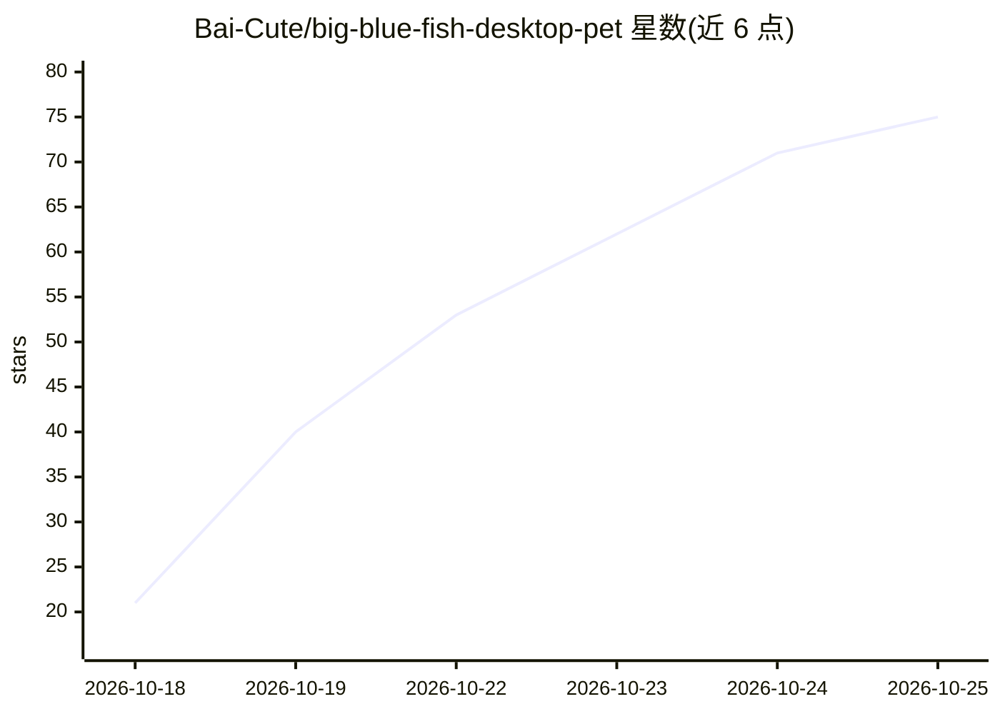

# Bai-Cute/big-blue-fish-desktop-pet

⭐ 75 · C# · Apache-2.0 · 推送 2026-10-19 · [GitHub](https://github.com/Bai-Cute/big-blue-fish-desktop-pet) · 个人维护 · 中文 README

**本地大模型驱动的蓝色鲸鱼娘 AI 桌面桌宠**

Windows/Linux 桌面宠物软件：内置 Qwen3.5-4B Q4_K_M 量化 GGUF 模型，由随包分发的 llama.cpp（Vulkan，可切 CPU）在本机离线推理。通过 OCR 读取前台窗口内容，结合天气（Open-Meteo）与科技新闻（IT之家 RSS），以鲸鱼娘人设从文字气泡生成陪伴话语；无对话历史、不留存读屏内容。内置 106 段动作表情动画，支持笔记本离电暂停推理、全屏自动隐藏，并提供可选 MCP 接口连接桌面 AI Agent 及彻底移除 MCP 的 Safe 版。提供安装包一键安装。

## 筛选速览

| 维度 | 判定 | 备注 |
|---|---|---|
| AI 角色 | `ai-native` | 本体是模型或模型工具 |
| 许可风险 | `permissive` | Apache-2.0 |
| 部署形态 | `desktop` | 安装包/桌面程序 |
| 模型依赖 | local-ok | 支持本地模型 |
| 硬件要求 | — | 无带数字的原话,不猜 |
| 安装摩擦 | `medium` | 含编译或系统依赖之一 |
| 成熟度 | — | 结构信号不足 |

## 能力要点

- 内置 4B 本地 GGUF 模型，llama.cpp 本机推理，读屏内容不上传
- OCR 识别前台窗口内容（Windows OCR / Tesseract），结合天气与科技新闻生成气泡话语
- 106 段动作表情动画，按时间/季节/节日/饭点动态触发
- 标准版提供 MCP 接口供桌面 Agent 控制，另有移除 MCP 的 Safe 版

## 适用场景

- 桌面上养一只会看屏幕、会说话的本地 AI 桌宠
- 离线、不上传读屏内容的隐私优先陪伴场景
- 通过 MCP 让桌面 Agent 操控桌宠动作与说话

## 场景标签

`AI 助手` `OCR` · 领域:对话与助手

## 证据(README 行号)

> L3: 蓝色大肥鱼是一款住在电脑桌面上的 AI 桌宠软件，支持 Windows 与 Linux 双平台。她是一位蓝发的小鲸鱼娘，形象来自对 DeepSeek 的二创虚拟形象“蓝色大肥鱼”。软件内置 4B 本地大模型，借助 OCR 技术读懂主
> L77: 鱼鱼使用 Qwen3.5-4B 的 Q4_K_M 量化 GGUF 模型，由随包分发的 llama.cpp（b10809，Vulkan 版本）在本机推理，可以使用 GPU 加速，也可以切换到 CPU 运行。两个预设来源的模型有所不同
> L24: 鱼鱼会读取当前前台窗口的画面，通过 OCR 识别其中的文字，并按照标题栏、侧边栏、正文等区域整理好，再交给内置的 4B 本地模型理解。无论主人在读文章、写文档、改代码，还是在聊天里提到了什么话题，她都能顺着眼前的内容组织一小段新的

## 星数曲线

2026-10-18 21 → 2026-10-25 75（+54）

---
*卡片 v1 · prompt 1.4 · 生成 2026-10-24 · 置信度 high · 依据 README sha `2ff6a586c5b0` · [字段定义](../../DATASET.md)*
