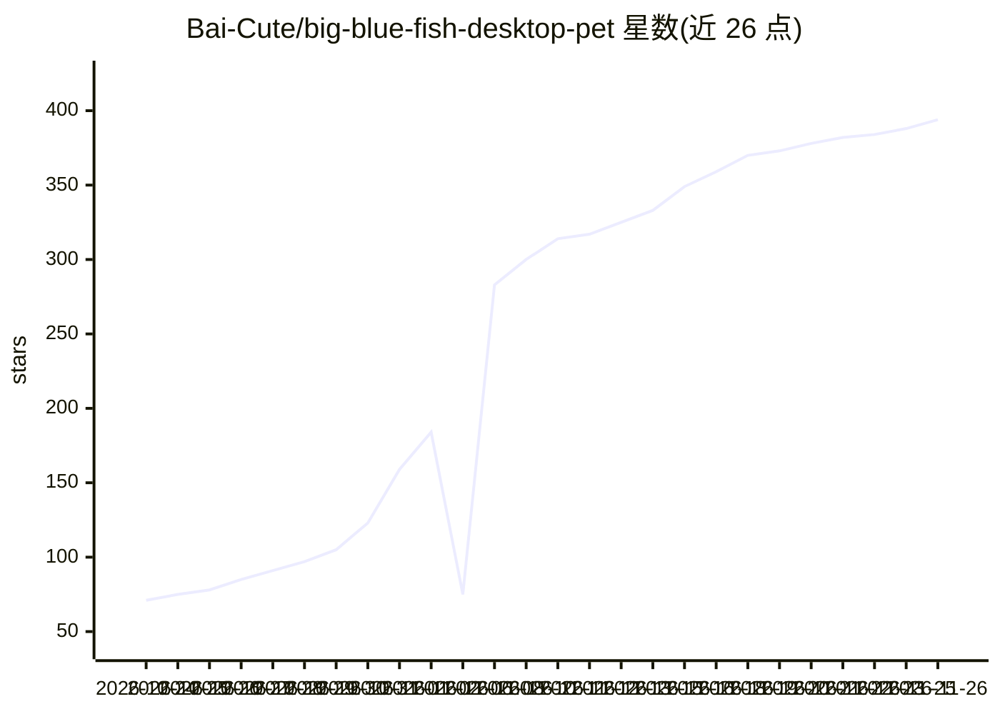

# Bai-Cute/big-blue-fish-desktop-pet

⭐ 394 · C# · Apache-2.0 · 推送 2026-11-25 · [GitHub](https://github.com/Bai-Cute/big-blue-fish-desktop-pet) · 个人维护 · 中文 README

**内置本地大模型的 Windows/Linux/macOS 桌宠陪伴应用**

以 DeepSeek 二创形象"蓝色大肥鱼"为角色的 AI 桌宠，面向普通用户。读取前台窗口画面并经 OCR（Windows/Mac/Linux 各用系统 OCR、Apple Vision、Tesseract）整理后交给内置 Qwen3.5-4B Q4_K_M GGUF 模型（随包分发 llama.cpp，Windows/Linux Vulkan、macOS Metal），以文字气泡输出陪伴语句；结合天气与 IT之家科技新闻生成播报。无对话历史与记忆，读屏内容不上传。提供 106 段动画、节日与季节动作；标准版可经 ACP 连接 21 款 CLI Agent 实现长对话与电脑操控，另有无ACP版移除该功能。

## 筛选速览

| 维度 | 判定 | 备注 |
|---|---|---|
| AI 角色 | `ai-native` | 本体是模型或模型工具 |
| 许可风险 | `permissive` | Apache-2.0 |
| 部署形态 | `desktop` | 安装包/桌面程序 |
| 模型依赖 | local-ok | 支持本地模型 |
| 硬件要求 | — | 无带数字的原话,不猜 |
| 安装摩擦 | `medium` | 含编译或系统依赖之一 |
| 成熟度 | — | 结构信号不足 |

## 能力要点

- 内置 4B 本地 GGUF 模型，llama.cpp 推理，支持 GPU/CPU 自动切换
- OCR 读屏后本地理解生成陪伴语句，读屏内容不上传云端
- 标准版经 ACP 连接 21 款 CLI Agent（Claude Code、Codex CLI 等）
- 106 段动画，覆盖节日、季节、三餐等场景，农历节日按农历计算

## 适用场景

- 在桌面上获得本地运行的 AI 陪伴角色
- 离线或注重隐私场景下使用读屏陪伴功能
- 连接本机 CLI Agent 进行长时间对话与电脑操作

## 场景标签

`AI 助手` · 领域:对话与助手

## 证据(README 行号)

> L17: 蓝色大肥鱼是一款住在电脑桌面上的 AI 桌宠软件，支持 Windows、Linux 与 macOS。她是一位蓝发的小鲸鱼娘，形象来自对 DeepSeek 的二创虚拟形象“蓝色大肥鱼”。软件内置 4B 本地大模型，借助 OCR 技术
> L38: 鱼鱼会读取当前前台窗口的画面，通过 OCR 识别其中的文字，并按照标题栏、侧边栏、正文等区域整理好，再交给内置的 4B 本地模型理解。无论主人在读文章、写文档、改代码，还是在聊天里提到了什么话题，她都能顺着眼前的内容组织一小段新的
> L102: 从 1.1.0 起，标准版的蓝色大肥鱼通过 ACP（Agent Client Protocol）连接主人电脑上已经安装的 CLI Agent。连接只需在设置里点选一次：鱼鱼会在后台启动所选的 Agent，为自己开一个专用对话，并

## 星数曲线

2026-10-24 71 → 2026-11-26 394（+323）

---
*卡片 v1 · prompt 1.4 · 生成 2026-11-26 · 置信度 high · 依据 README sha `cee6825687df` · [字段定义](../../DATASET.md)*
