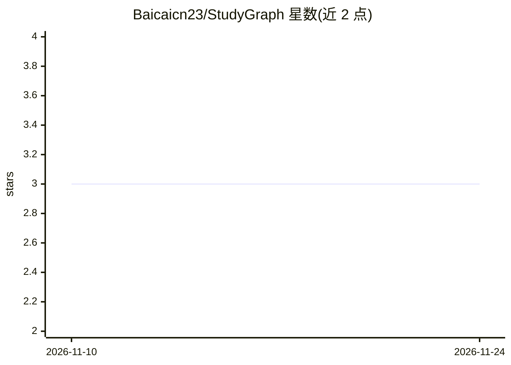

# Baicaicn23/StudyGraph

⭐ 3 · Python · Apache-2.0 · 推送 2026-10-23 · [GitHub](https://github.com/Baicaicn23/StudyGraph) · 个人维护 · 中文 README

**面向大学生的学习助理：资料整理、自动出题与复习排期**

以 LangGraph 编排的个人学习助理，围绕三个功能组织：整理讲义/课件/错题照片并按学科入库，依据资料自动出题并派生变式题，按掌握度与到期时间生成间隔重复复习计划。回合以状态图（route→plan→agent⇄tools）运行，写入操作经 interrupt() 人工确认，SSE 流式推送过程，带检索评测门禁、token 记账与预算控制。默认 Mock 模型零成本运行，可通过 .env 接入 OpenAI 兼容平台。单用户、无鉴权。

## 筛选速览

| 维度 | 判定 | 备注 |
|---|---|---|
| AI 角色 | `ai-native` | 本体是模型或模型工具 |
| 许可风险 | `permissive` | Apache-2.0 |
| 部署形态 | `library` | 以包/库形式分发 |
| 模型依赖 | — | README 未给出锁定关系 |
| 硬件要求 | — | 无带数字的原话,不猜 |
| 安装摩擦 | `low` | 无编译、无系统依赖或容器化 |
| 成熟度 | — | 结构信号不足 |

## 能力要点

- 六类意图路由到子智能体，LangGraph 状态图可恢复可拦截
- 四路召回（FTS/扩写/LIKE/向量）+ RRF 融合，检索评测带基线门禁
- 错题按错误类型聚合，按错因派生变式题，间隔重复排期为确定性算法
- 默认 Mock 模型，零 API 消耗；写入前 HITL 确认

## 适用场景

- 把讲义和课件整理成可检索的学科知识库
- 根据资料自动生成练习题并按错因出变式题
- 按掌握度和到期时间安排每日复习
- 本地跑通带评测门禁的 LangGraph agent 项目

## 场景标签

`知识库管理` `文档问答` · 领域:知识与检索

## 证据(README 行号)

> L5: 面向大学生的个人学习助理 —— 传进讲义和错题照片，它帮你整理出题、排好复习。
> L29: 知迹把一次学习回合做成一张**可恢复、可拦截、可度量**的状态图 —— 断了能接着跑，
> L86: - **判意图再作答** —— 六类意图（讲解 / 练习 / 进度 / 检索 / 计算 / 闲聊）路由到不同子智能体

## 星数曲线

2026-11-10 3 → 2026-11-24 3（+0）

---
*卡片 v1 · prompt 1.4 · 生成 2026-11-22 · 置信度 high · 依据 README sha `cd7cc9f58186` · [字段定义](../../DATASET.md)*
