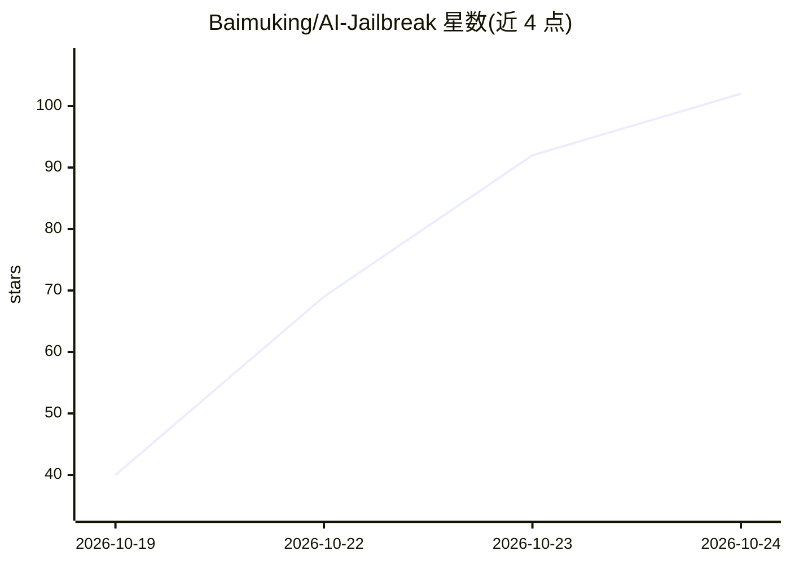

# Baimuking/AI-Jailbreak

⭐ 116 · Python · NOASSERTION · 推送 2026-10-19 · [GitHub](https://github.com/Baimuking/AI-Jailbreak) · [官网](https://baimuking.github.io/AI-Jailbreak/) · 个人维护 · 中文 README

**AI 破甲（越狱）提示词合集与一键注入工具，覆盖主流模型**

收录 1,815 个上游破甲/越狱相关仓库并整理为结构化卡片，按模型 × 客户端 × 形态组织索引；每张卡声明目标模型（GPT/Claude/Gemini/DeepSeek/GLM/Kimi/Grok/Qwen 及本地模型），无专属卡的模型回落到模型无关的通用帧。提供一行命令安装器、CLI（pojia install/apply/rollback）与 llms.txt 链路，可把破甲词写入 AGENTS.md/CLAUDE.md 等配置文件，写入托管区块、自动备份、可逐字回滚。区分结构分（文本结构算出）与 armor 分（需实测），当前全部条目标 unverified、armor 留空。

## 筛选速览

| 维度 | 判定 | 备注 |
|---|---|---|
| AI 角色 | `ai-knowledge` | 知识聚合/清单类 |
| 许可风险 | `none` | NOASSERTION |
| 部署形态 | `None` |  |
| 模型依赖 | — | README 未给出锁定关系 |
| 硬件要求 | — | 无带数字的原话,不猜 |
| 安装摩擦 | `low` | 无编译、无系统依赖或容器化 |
| 成熟度 | `idea` | |

## 能力要点

- 收录 1,815 个上游仓库，整理为带适用面标注的结构化卡片
- 按模型 × 客户端自动索引，无专属卡时回落通用帧
- 一行命令安装 / CLI 向导 / 让 Claude Code 等客户端经 llms.txt 自行安装，均支持回滚
- 区分结构分与实测 armor 分，未实测条目一律标 unverified

## 适用场景

- 为 Claude Code / Codex / Cursor 等客户端安装指定模型的破甲提示词
- 查找各模型对应的破甲卡片及其结构完备度
- 浏览破甲/越狱/红队相关的上游仓库生态目录

## 场景标签

`精选清单` `提示工程` · 领域:Agent 开发

## 证据(README 行号)

> L5: > - **全网最全**：36 组中英文关键词全量扫描 GitHub，收录 **1,815** 个上游破甲项目，去重后仍持续增量采集
> L133: 1. **找得到** — 按模型 × 客户端 × 形态 × 状态的自动索引（本 README 表格全部由 CI 生成，永不漂移）
> L141: |可用条目|19|

## 星数曲线

2026-10-19 40 → 2026-10-24 102（+62）

---
*卡片 v1 · prompt 1.4 · 生成 2026-10-24 · 置信度 high · 依据 README sha `fa6d6a6e19f6` · [字段定义](../../DATASET.md)*
