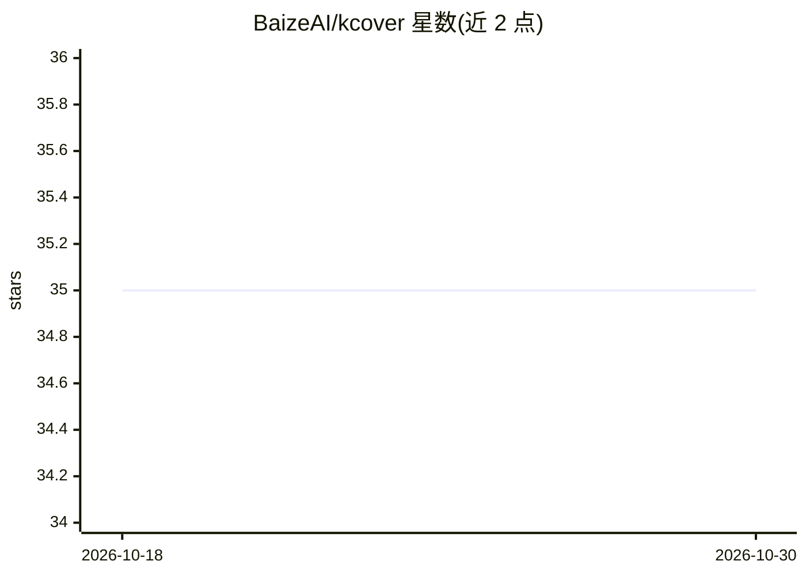

# BaizeAI/kcover

⭐ 35 · Go · Apache-2.0 · 推送 2026-10-28 · [GitHub](https://github.com/BaizeAI/kcover) · [官网](https://baizeai.github.io/talks/2024-08-21-kubecon-hk/#/1) · 组织维护

**K8s 大规模 AI 训练负载的故障感知与快速恢复组件**

kcover 是部署在 Kubernetes 上的控制器加节点 Agent：通过给 PytorchJob 等资源打标签，自动监测硬件、网络、软件故障并执行恢复动作，减少分布式训练与服务的停机。Agent 将预检结果压缩为 PreflightReport CRD 上报，控制器按 workload UID 聚合，支持两两批次慢节点检测、总线带宽阈值评估与报告收集超时。提供 base 与 MetaX 两种 Agent 镜像（后者需特权容器访问 Infiniband 设备），通过 Helm 安装，要求 Kubernetes 1.25+。

## 筛选速览

| 维度 | 判定 | 备注 |
|---|---|---|
| AI 角色 | `ai-ecosystem` | LLM/agent 周边工具 |
| 许可风险 | `permissive` | Apache-2.0 |
| 部署形态 | `self-host` | docker 或自建部署 |
| 模型依赖 | — | README 未给出锁定关系 |
| 硬件要求 | — | 无带数字的原话,不猜 |
| 安装摩擦 | `low` | 无编译、无系统依赖或容器化 |
| 成熟度 | — | 结构信号不足 |

## 能力要点

- 监测硬件/网络/软件故障并对打标签资源执行自动恢复
- PreflightReport CRD 聚合与两两批次慢节点检测
- base 通用镜像（多架构）与 MetaX 专用镜像两种 flavor
- Helm 安装、Controller 支持多副本 Leader Election

## 适用场景

- 大规模 GPU/MetaX 分布式训练集群的故障自动恢复
- 训练任务上线前预检慢节点并提前剔除
- 保障 LLMOps/MLOps 工作负载的持续可用性

## 场景标签

`MLOps` · 领域:训练与推理

## 证据(README 行号)

> L3: Welcome to `kcover`, a Kubernetes solution designed to enhance the reliability and resilience of large-scale AI work
> L103: kubectl label pytorchjobs <job-name> kcover.io/cascading-recovery=true
> L209: Once installed, `kcover` will automatically monitor the labeled resources for any signs of failures and perform re

## 星数曲线

2026-10-18 35 → 2026-10-30 35（+0）

---
*卡片 v1 · prompt 1.4 · 生成 2026-10-25 · 置信度 mid · 依据 README sha `67990b5dee77` · [字段定义](../../DATASET.md)*
