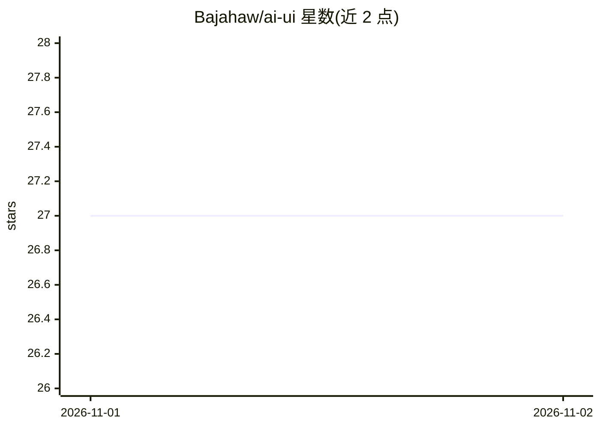

# Bajahaw/ai-ui

⭐ 27 · TypeScript · MIT · 推送 2026-10-28 · [GitHub](https://github.com/Bajahaw/ai-ui) · [官网](https://bajahaw.com/blogs/better-ai-chat.html) · 个人维护

**轻量多用户 AI 聊天界面（React + Golang）**

基于 React 与 Golang 的自托管 AI 聊天界面：支持多会话、历史、编辑与分支，多用户登录，接入 OpenAI 兼容的多种 AI 提供商，并可通过 ChatGPT 账号登录作为提供商；包含 Tools/MCP 集成、Agentic 文档检索与深浅色主题。官方以 Docker 镜像部署，需设置 ENCRYPTION_KEY 环境变量（丢失则已存 API 密钥不可恢复），README 提示安全性有限，建议本地或自有安全环境使用。

## 筛选速览

| 维度 | 判定 | 备注 |
|---|---|---|
| AI 角色 | `ai-ecosystem` | LLM/agent 周边工具 |
| 许可风险 | `permissive` | MIT |
| 部署形态 | `self-host` | docker 或自建部署 |
| 模型依赖 | — | README 未给出锁定关系 |
| 硬件要求 | — | 无带数字的原话,不猜 |
| 安装摩擦 | `low` | 无编译、无系统依赖或容器化 |
| 成熟度 | — | 结构信号不足 |

## 能力要点

- 多提供商支持（OpenAI 兼容接口）
- 会话分支、编辑与历史管理
- Tools/MCP 集成与 Agentic 文档检索
- 内存占用约 30MB

## 适用场景

- 本地或内网自建多用户 AI 聊天入口
- 统一接入多个 OpenAI 兼容模型服务
- 带文档检索的团队对话工具

## 场景标签

`聊天机器人` `文档问答` · 领域:对话与助手

## 证据(README 行号)

> L16: - Multi-provider AI support (OpenAI compatible ones)
> L17: - Sign in with ChatGPT — connect your ChatGPT account as a provider

## 星数曲线

2026-11-01 27 → 2026-11-02 27（+0）

---
*卡片 v1 · prompt 1.4 · 生成 2026-10-31 · 置信度 high · 依据 README sha `edbb943bfb48` · [字段定义](../../DATASET.md)*
