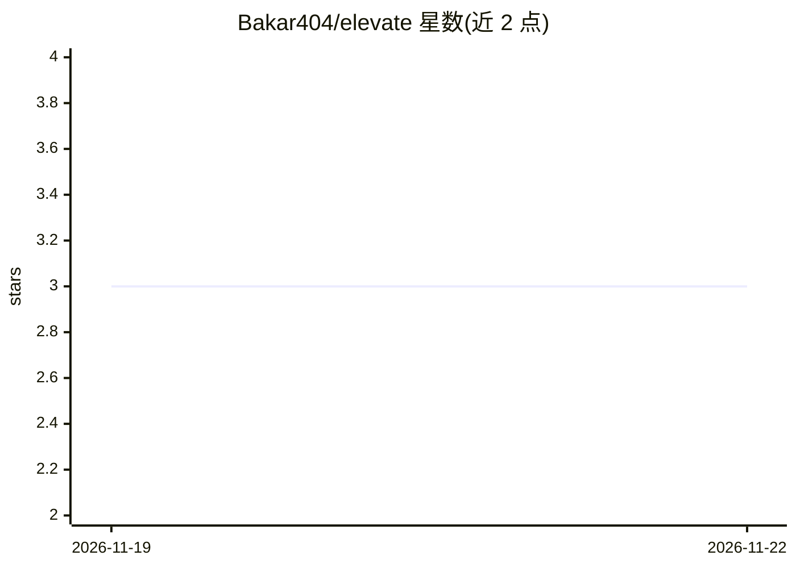

# Bakar404/elevate

⭐ 3 · TypeScript · MIT · 推送 2026-11-17 · [GitHub](https://github.com/Bakar404/elevate) · [官网](https://bakar404.github.io/elevate/) · 个人维护

**为开发者的仓库监控新技术并自动开草稿 PR 的 agent 工具**

elevate 监听用户选择的来源（新闻、arXiv、AI 实验室博客、任意 RSS/Atom 源），发现可能改进其 GitHub 仓库的新技术后经两道门核查：来源可信度与独立佐证，以及对仓库的适配性与可度量收益；用户批准后派出多个 agent 规划、实现、测试、评审并开草稿 PR，随后跟踪 CI 检查，可配置自动 squash 合并。默认模型运行时为 GitHub Copilot SDK，走 Copilot 订阅，也支持自带 Anthropic/OpenAI/Azure key。推荐排序用上下文老虎机（贝叶斯逻辑回归 + Bayes-UCB）学习用户偏好。基于 Next.js 与 Postgres，提供 pnpm 与 Docker 两种部署方式。

## 筛选速览

| 维度 | 判定 | 备注 |
|---|---|---|
| AI 角色 | `ai-ecosystem` | LLM/agent 周边工具 |
| 许可风险 | `permissive` | MIT |
| 部署形态 | `self-host` | docker 或自建部署 |
| 模型依赖 | — | README 未给出锁定关系 |
| 硬件要求 | — | 无带数字的原话,不猜 |
| 安装摩擦 | `low` | 无编译、无系统依赖或容器化 |
| 成熟度 | — | 结构信号不足 |

## 能力要点

- 双门核查：来源可信度/佐证 + 仓库适配性与可度量收益，通过才推荐
- agent swarm 完成规划、实现、测试、评审并开草稿 PR，跟踪 CI 至可合并
- 上下文老虎机（贝叶斯逻辑回归、Bayes-UCB）从 👍/👎 学习推荐排序
- 支持 Copilot coding agent、Claude、Codex cloud 或本地 copilot/claude/codex CLI 作为 swarm 运行时

## 适用场景

- 让 AI 实验室博客与 arXiv 的新方法自动匹配到我的仓库并起草改进 PR
- 过滤例行补丁与 deprecation，只接收前沿 AI 技术推荐
- 在手机上查看推荐收件箱与 swarm 运行状态
- 离线 demo 模式下无 GitHub 依赖地试用流程

## 场景标签

`多智能体` `编码 Agent` · 领域:Agent 开发

## 证据(README 行号)

> L26: Proof-driven development, speculative decoding, weight-space editing, whatever lands next. elevate watches the sour
> L31: You approve, and elevate sends a swarm of agents that plan, implement, test and review the change, then open a **dr
> L45: The model runtime is the GitHub Copilot SDK, so it runs on your Copilot subscription. You can bring your own key fo

## 星数曲线

2026-11-19 3 → 2026-11-22 3（+0）

---
*卡片 v1 · prompt 1.4 · 生成 2026-11-22 · 置信度 high · 依据 README sha `29e539cfaae6` · [字段定义](../../DATASET.md)*
