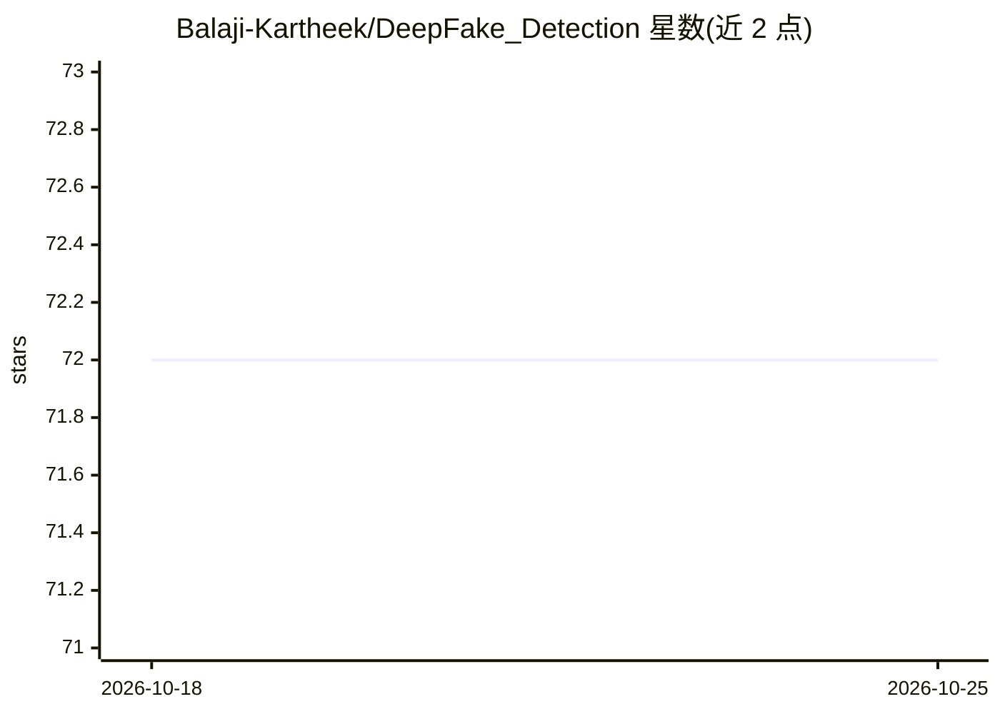

# Balaji-Kartheek/DeepFake_Detection

⭐ 72 · Jupyter Notebook · 推送 2025-12-10 · [GitHub](https://github.com/Balaji-Kartheek/DeepFake_Detection) · [官网](https://github.com/Balaji-Kartheek/DeepFake_Detection/) · 个人维护

**检测视频真伪的深度学习项目：CNN+GRU 分类 Real/Fake**

端到端深度学习检测系统：对视频逐帧提取人脸区域，用预训练 CNN（InceptionV3/EfficientNetB2）提取特征向量，再经 GRU 序列模型分类视频为 REAL 或 FAKE，在 DFDC 采样数据集上测试准确率约 85%。也实验过 MesoNet、ResNet50、EfficientNetB0 等纯 CNN 方案。流程为 pip 安装依赖后运行 deploy 目录下 main.py，README 提示建议在 GPU 上运行，10 秒 30fps 视频约一分钟出结果。限制：多面孔视频与暗背景帧下检测效果下降。

## 筛选速览

| 维度 | 判定 | 备注 |
|---|---|---|
| AI 角色 | `ai-native` | 本体是模型或模型工具 |
| 许可风险 | `none` | — |
| 部署形态 | `library` | 以包/库形式分发 |
| 模型依赖 | — | README 未给出锁定关系 |
| 硬件要求 | — | 无带数字的原话,不猜 |
| 安装摩擦 | `low` | 无编译、无系统依赖或容器化 |
| 成熟度 | — | 结构信号不足 |

## 能力要点

- CNN（InceptionV3/EfficientNetB2）+ GRU 序列模型分类视频真伪
- 在 DFDC 采样数据集上测试准确率约 85%
- 逐帧人脸定位与特征提取后聚合判定的流水线
- 对比实验了 MesoNet、ResNet50、EfficientNetB0 等纯 CNN 方案

## 适用场景

- 检测换脸类 DeepFake 视频是否为伪造
- 社交媒体平台上传内容的真伪预警功能原型
- 学习 CNN+RNN 组合的视频分类工程实现

## 场景标签

`网络安全` · 领域:学习与行业

## 证据(README 行号)

> L40: - Build a model that processes the given video and classifies it as REAL or FAKE.
> L122: - Combination of CNN and RNN model is used to detect Fake Videos. We achieved a test accuracy ~85% on sample DFDC 

## 星数曲线

2026-10-18 72 → 2026-10-25 72（+0）

---
*卡片 v1 · prompt 1.4 · 生成 2026-10-24 · 置信度 high · 依据 README sha `7444af9b99fc` · [字段定义](../../DATASET.md)*
