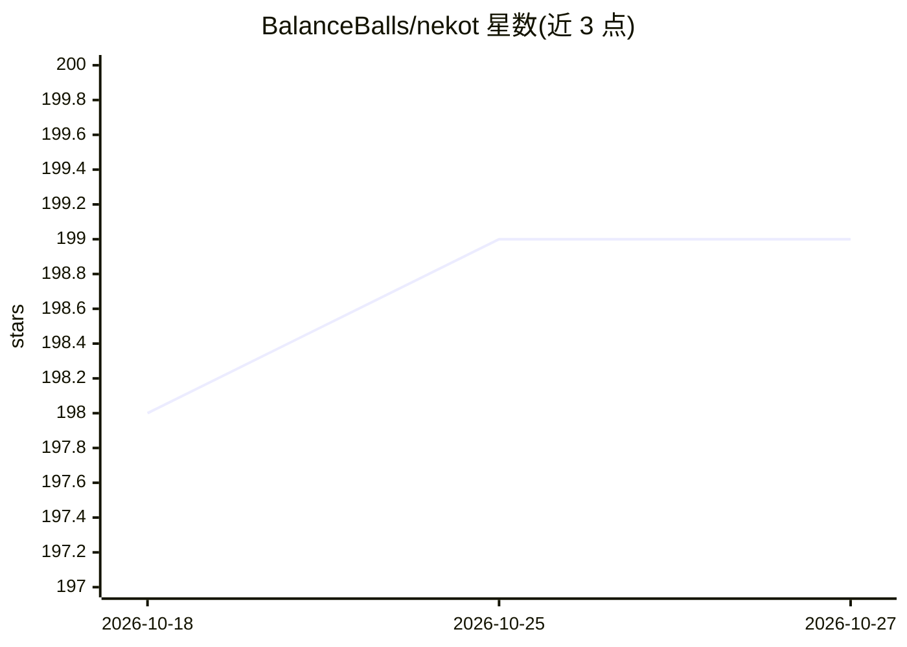

# BalanceBalls/nekot

⭐ 199 · Go · MIT · 推送 2026-07-16 · [GitHub](https://github.com/BalanceBalls/nekot) · 个人维护

**终端 TUI 中与本地及云端 LLM 对话的便携客户端**

用 Go 编写的单二进制终端 AI 聊天界面，面向偏好键盘驱动工作流的用户。支持 OpenAI 兼容 API（可指向 ChatGPT、Mistral、Ollama、LMStudio、llama-cpp 等任意兼容端点）、Gemini API 与 OpenRouter API。提供聊天会话管理、人设设置预设、图片附件、stdin 管道输入、BETA 状态的 web search 工具（DuckDuckGo/Brave，bm25 打分）与 vim 风格文本选择。API key 可经环境变量或自定义命令从密码管理器解析；数据存于 ~/.nekot 目录。限制：web search 为 BETA 且会显著增加 token 用量。

## 筛选速览

| 维度 | 判定 | 备注 |
|---|---|---|
| AI 角色 | `ai-ecosystem` | LLM/agent 周边工具 |
| 许可风险 | `permissive` | MIT |
| 部署形态 | `None` |  |
| 模型依赖 | local-ok | 支持本地模型 |
| 硬件要求 | — | 无带数字的原话,不猜 |
| 安装摩擦 | `low` | 无编译、无系统依赖或容器化 |
| 成熟度 | `idea` | |

## 能力要点

- 单二进制、零依赖，跨 macOS/Windows/Linux
- 支持 OpenAI 兼容 API、Gemini、OpenRouter 三类 provider，可指向本地 Ollama/LMStudio 端点
- apiKeyResolveCommand 从安全存储/密码管理器 CLI 解析 API key
- stdin 管道输入与多会话、多设置预设管理

## 适用场景

- 在终端里直接与本地或云端 LLM 对话
- 把提示文件通过管道喂给模型快速生成结果
- 用不同预设切换模型参数与人设配置多类任务

## 场景标签

`聊天机器人` · 领域:对话与助手

## 证据(README 行号)

> L9:  * 🤖 **Support for OpenAI compatible APIs** (ChatGPT, Mistral, Ollama, LMStudio, llama-cpp and more)
> L175: Available providers:

## 星数曲线

2026-10-18 198 → 2026-10-27 199（+1）

---
*卡片 v1 · prompt 1.4 · 生成 2026-10-22 · 置信度 high · 依据 README sha `b3f799dbc7c4` · [字段定义](../../DATASET.md)*
