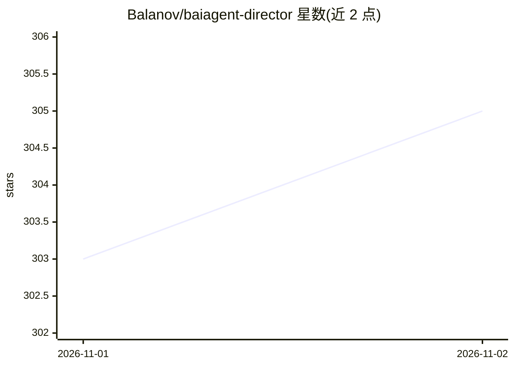

# Balanov/baiagent-director

⭐ 305 · JavaScript · AGPL-3.0 · 推送 2026-11-01 · [GitHub](https://github.com/Balanov/baiagent-director) · [官网](https://baiagent.ru/free/) · 个人维护

**本地优先的 AI 商业顾问：调研带证据、生成可验证试点方案**

面向企业用户的 AI 商业顾问应用：输入公司网站后自动研究产品、价格、竞品与市场信号并附来源地址，区分事实与假设，输出因果假设链与含度量指标、预算公式和停止标准的试点计划。Windows 桌面版基于 Electron，支持本地文档（TXT/PDF/DOCX 等）对话，通过已有 Ollama 使用 Qwen 或下载 Qwen3-4B 本地模型（约 2.4GB，建议 8GB RAM）。明确声明自身是顾问而非自主执行者，不做 CRM 操作；代码采用 AGPL-3.0。

## 筛选速览

| 维度 | 判定 | 备注 |
|---|---|---|
| AI 角色 | `ai-native` | 本体是模型或模型工具 |
| 许可风险 | `viral` | AGPL-3.0 |
| 部署形态 | `None` |  |
| 模型依赖 | local-ok | 支持本地模型 |
| 硬件要求 | — | 无带数字的原话,不猜 |
| 安装摩擦 | `low` | 无编译、无系统依赖或容器化 |
| 成熟度 | — | 结构信号不足 |

## 能力要点

- 基于公司网站的自动化调研，结果附带来源地址
- 因果假设链：观察→机制→行动→验证方式
- 试点方案含度量、预算公式与停止标准
- 本地运行 Qwen（经 Ollama 或下载 Qwen3-4B），无需云端 API key

## 适用场景

- 我想让 AI 帮我调研公司业务并给出可验证的改进方案
- 在本地离线用 Qwen 模型与自己的文档对话
- 制定带指标和边界的业务试点计划

## 场景标签

`文档问答` `网页抓取` · 领域:效率与自动化

## 证据(README 行号)

> L5: Укажите сайт компании. Советник исследует открытые страницы и внешние упоминания, отделяет факты от гипотез, показыв
> L24: - Qwen через существующую локальную Ollama или загружаемая модель Qwen3-4B — без обязательного облачного API-ключа.

## 星数曲线

2026-11-01 303 → 2026-11-02 305（+2）

---
*卡片 v1 · prompt 1.4 · 生成 2026-10-31 · 置信度 high · 依据 README sha `e9466392073c` · [字段定义](../../DATASET.md)*
