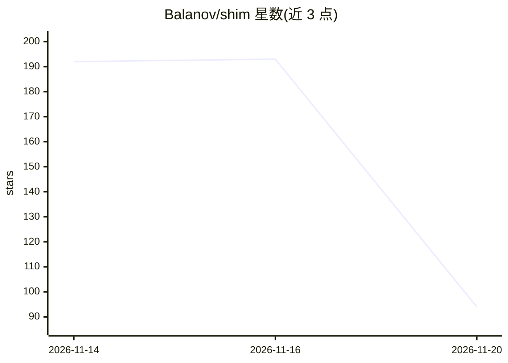

# Balanov/shim

⭐ 94 · Go · MIT · 推送 2026-11-15 · [GitHub](https://github.com/Balanov/shim) · [官网](https://balanov.pro/shim/) · 个人维护 · 中文 README

**零依赖的本地优先终端 AI harness：接任意模型、MCP 与 Skills**

Go 编写的单静态二进制 CLI，作为终端与模型、MCP 服务器、Agent Skills 之间的适配层。内置 OpenAI 兼容与 Anthropic 适配器及多家预设（Ollama、LM Studio、llama.cpp、OpenRouter 等），本地 GGUF 权重需经这些推理服务器运行，Shim 自身不含推理引擎。可用本地小模型作命令路由，把自然语言管理请求翻译为白名单命令，变更类命令需确认；默认 ask 权限模式要求写文件、shell 与 MCP 调用须确认。仅用 Go 标准库，配置为纯 JSON，会话为 JSONL 追加，密钥仅从环境变量读取。

## 筛选速览

| 维度 | 判定 | 备注 |
|---|---|---|
| AI 角色 | `ai-ecosystem` | LLM/agent 周边工具 |
| 许可风险 | `permissive` | MIT |
| 部署形态 | `desktop` | 安装包/桌面程序 |
| 模型依赖 | local-ok | 支持本地模型 |
| 硬件要求 | — | 无带数字的原话,不猜 |
| 安装摩擦 | `low` | 无编译、无系统依赖或容器化 |
| 成熟度 | — | 结构信号不足 |

## 能力要点

- 单个静态二进制，零运行时依赖，仅用 Go 标准库
- 支持任意 OpenAI 兼容/Anthropic HTTP API，附 Ollama/LM Studio/llama.cpp 等预设
- MCP（stdio 与 Streamable HTTP）与 SKILL.md 懒加载技能发现
- 本地小模型作为白名单命令路由，变更操作需确认

## 适用场景

- 在终端统一接入多家云端与本地模型
- 给 coding agent 挂载 MCP 工具与 Agent Skills
- 用自然语言管理模型、技能与 MCP 配置

## 场景标签

`模型网关` `Agent 框架` · 领域:Agent 开发

## 证据(README 行号)

> L27: - **Use a local mini-model as the command router.** It translates management requests into an allowlisted command. 
> L117: “Any model” means any model exposed through a supported HTTP API. GGUF and other local weights run through Ollama,
> L195: |OpenCode|Full-featured provider-agnostic terminal workspace|No TUI/server surface; conversational setup and a tin

## 星数曲线

2026-11-14 192 → 2026-11-20 94（-98）

---
*卡片 v1 · prompt 1.4 · 生成 2026-11-17 · 置信度 mid · 依据 README sha `2ad200575458` · [字段定义](../../DATASET.md)*
