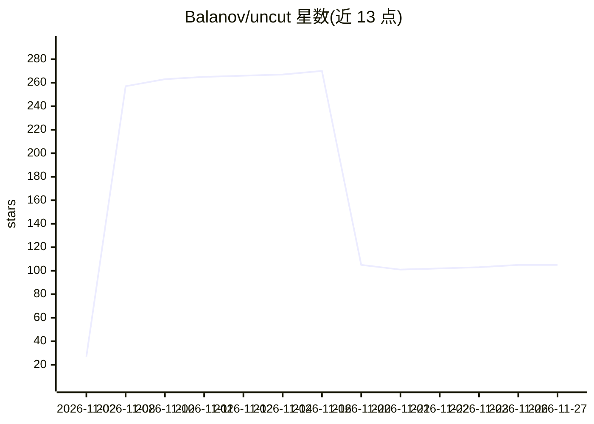

# Balanov/uncut

⭐ 105 · Go · MIT · 推送 2026-11-25 · [GitHub](https://github.com/Balanov/uncut) · [官网](https://balanov.pro/uncut/) · 个人维护 · 中文 README

**单二进制的无头编码 agent harness，全程不截断上下文与输出**

用 Go 编写的命令行编码 agent harness：通过 stdin/stdout 与管道集成，提供 read_file/write_file/replace/run_command 四个工具，每次模型调用发送完整对话，文件内容与命令输出不做截断；若提供方在输出上限处截断响应则以错误码退出而非给出部分结果。兼容 OpenAI Chat Completions 端点（含 OpenRouter 与本地 Ollama，示例搭配 qwen3:8b 实测），支持 JSONL 会话追加与恢复、NDJSON 事件流。刻意不提供 TUI、遥测、插件系统、自动重试与上下文压缩；非沙箱，shell 命令以当前用户权限执行。以 7 MB 静态二进制分发（Linux/macOS/Windows，amd64/arm64），也可用 go install 或源码构建。

## 筛选速览

| 维度 | 判定 | 备注 |
|---|---|---|
| AI 角色 | `ai-ecosystem` | LLM/agent 周边工具 |
| 许可风险 | `permissive` | MIT |
| 部署形态 | `desktop` | 安装包/桌面程序 |
| 模型依赖 | local-ok | 支持本地模型 |
| 硬件要求 | — | 无带数字的原话,不猜 |
| 安装摩擦 | `low` | 无编译、无系统依赖或容器化 |
| 成熟度 | — | 结构信号不足 |

## 能力要点

- 单静态 Go 二进制，无第三方 Go 依赖，四工具+单 agent 循环
- 无截断契约：内容与输出完整传输，提供方截断时显式报错（exit 3）
- append-only JSONL 会话完整保存消息与工具结果，可恢复
- OpenAI 兼容端点，支持本地 Ollama（qwen3:8b 冒烟测试）

## 适用场景

- 在 shell 管道与 CI 任务中运行编码 agent
- 审查 diff、排查失败测试日志
- 需要可审计完整上下文的 agent 实验
- 本地模型驱动的无界面编码任务

## 场景标签

`编码 Agent` · 领域:编码与开发

## 证据(README 行号)

> L20: UNCUT is a tiny coding-agent harness for shell pipelines, CI jobs, containers, and agent experiments. It deliberate
> L29: - **Provider neutral.** Works with OpenAI-compatible Chat Completions endpoints, including local servers.
> L122: For a local Ollama server with an installed tool-capable model (this exact setup was smoke-tested with `qwen3:8b`)

## 星数曲线

2026-11-02 27 → 2026-11-27 105（+78）

---
*卡片 v1 · prompt 1.4 · 生成 2026-11-17 · 置信度 high · 依据 README sha `d4c9b55ac9d4` · [字段定义](../../DATASET.md)*
