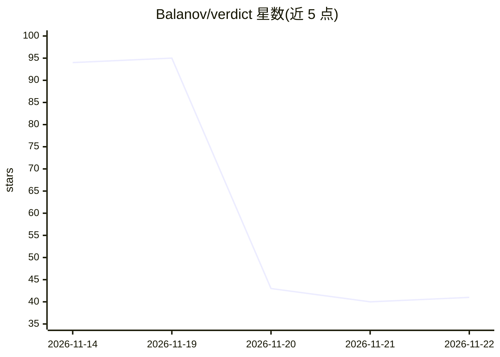

# Balanov/verdict

⭐ 41 · Python · Apache-2.0 · 推送 2026-11-15 · [GitHub](https://github.com/Balanov/verdict) · 个人维护

**197KB 本地语义分类器：判定 CLI 工具调用真实结果**

面向编码 agent、CI 与工具调用系统的语义结果层：读取命令、退出码、stdout 与 stderr，输出 success/failure/blocked/unknown 四类标签及置信度，替代仅依赖退出码的判断。模型为字符 n-gram + 多类逻辑回归，197KB int8 权重，纯 Python 标准库本地 CPU 推理，无网络与遥测。训练与基准语料均为合成数据，作者声明语料偏向英语，生产级真实 trace 验证为后续目标；定位为建议性分类器，不替代确定性检查。

## 筛选速览

| 维度 | 判定 | 备注 |
|---|---|---|
| AI 角色 | `ai-native` | 本体是模型或模型工具 |
| 许可风险 | `permissive` | Apache-2.0 |
| 部署形态 | `library` | 以包/库形式分发 |
| 模型依赖 | — | README 未给出锁定关系 |
| 硬件要求 | — | 无带数字的原话,不猜 |
| 安装摩擦 | `low` | 无编译、无系统依赖或容器化 |
| 成熟度 | `idea` | |

## 能力要点

- 读取命令/退出码/stdout/stderr 输出四类语义标签
- 197KB int8 模型，纯 Python 标准库本地 CPU 推理，无依赖
- 保留测试集上 93.2% 准确率（退出码基线 47.9%），可脚本复现
- 提供 Python API、CLI 与浏览器内运行同一量化权重的演示

## 适用场景

- agent 工具调用后判断真实成败，决定重试还是停止
- CI 流水线中识别零测试收集等假成功情况
- 区分环境阻断（blocked）与断言失败（failure）

## 场景标签

 · 领域:AI agent 安全/评测

## 证据(README 行号)

> L2:  A 197 KB local semantic outcome classifier for CLI tool calls.
> L21: Verdict is a research preview of a semantic outcome layer for coding agents, CI runners, and tool-using systems. It

## 星数曲线

2026-11-14 94 → 2026-11-22 41（-53）

---
*卡片 v1 · prompt 1.4 · 生成 2026-11-17 · 置信度 mid · 依据 README sha `55d10230bfed` · [字段定义](../../DATASET.md)*
