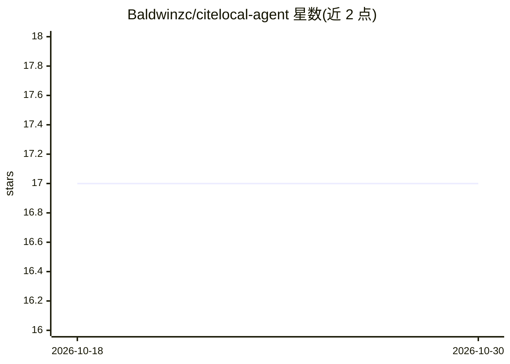

# Baldwinzc/citelocal-agent

⭐ 17 · Python · MIT · 推送 2026-06-28 · [GitHub](https://github.com/Baldwinzc/citelocal-agent) · 个人维护 · 中文 README

**本地论文问答 agent：对 PDF 提问并给页码级校验引用**

面向研究者的本地优先论文研究助手：把本地 PDF/Markdown 等文档建索引，agent 基于 LangGraph 自主检索、改写查询并综合多篇论文作答，每条引用精确到 PDF 页码且对照检索内容校验，不支持的问题会被拒答。embedding 本地运行，作答模型可经 OpenAI 兼容网关或 Ollama 本地运行。提供 CLI 与 FastAPI Web UI，检索栈为 dense(bge)+BM25→RRF→cross-encoder 重排。限制：用 pypdf 纯文本抽取，表格/公式/多栏版式会被拍平。

## 筛选速览

| 维度 | 判定 | 备注 |
|---|---|---|
| AI 角色 | `ai-native` | 本体是模型或模型工具 |
| 许可风险 | `permissive` | MIT |
| 部署形态 | `self-host` | docker 或自建部署 |
| 模型依赖 | local-ok | 支持本地模型 |
| 硬件要求 | — | 无带数字的原话,不猜 |
| 安装摩擦 | `low` | 无编译、无系统依赖或容器化 |
| 成熟度 | — | 结构信号不足 |

## 能力要点

- 引用精确到 PDF 页码并对照检索校验，幻觉引用被丢弃
- 混合检索：dense(bge)+BM25 → RRF → cross-encoder 重排
- 跨论文多跳问答与诚实拒答（相关性阈值）
- 可选 Ollama 本地作答模型与可选联网搜索（引用同样可验证）

## 适用场景

- 对本地一堆论文提问，得到带页码出处的答案
- 敏感或未发表论文不离开本机的私有问答
- 跨多篇论文综合事实、比较多跳问题

## 场景标签

`文档问答` `RAG` `科研工具` · 领域:知识与检索

## 证据(README 行号)

> L5: 针对一堆论文(或任意本地文档)提问,得到**精确到页码、且经过校验的引用**答案 —— **全程在本机运行**。基于 LangGraph。
> L7: 云端论文工具(ChatPDF、Elicit……)要你**上传 PDF**。citelocal-agent 不用:embedding 本地跑,论文不出本机(`papers/` 已 gitignore),作答模型也可用 Ollama 本
> L11: - 🔒 **全本地 / 隐私** —— PDF 绝不上传;本地 embedding,可选本地 LLM(Ollama)。适合未发表或敏感论文。

## 星数曲线

2026-10-18 17 → 2026-10-30 17（+0）

---
*卡片 v1 · prompt 1.4 · 生成 2026-10-30 · 置信度 high · 依据 README sha `50ae833f1be4` · [字段定义](../../DATASET.md)*
