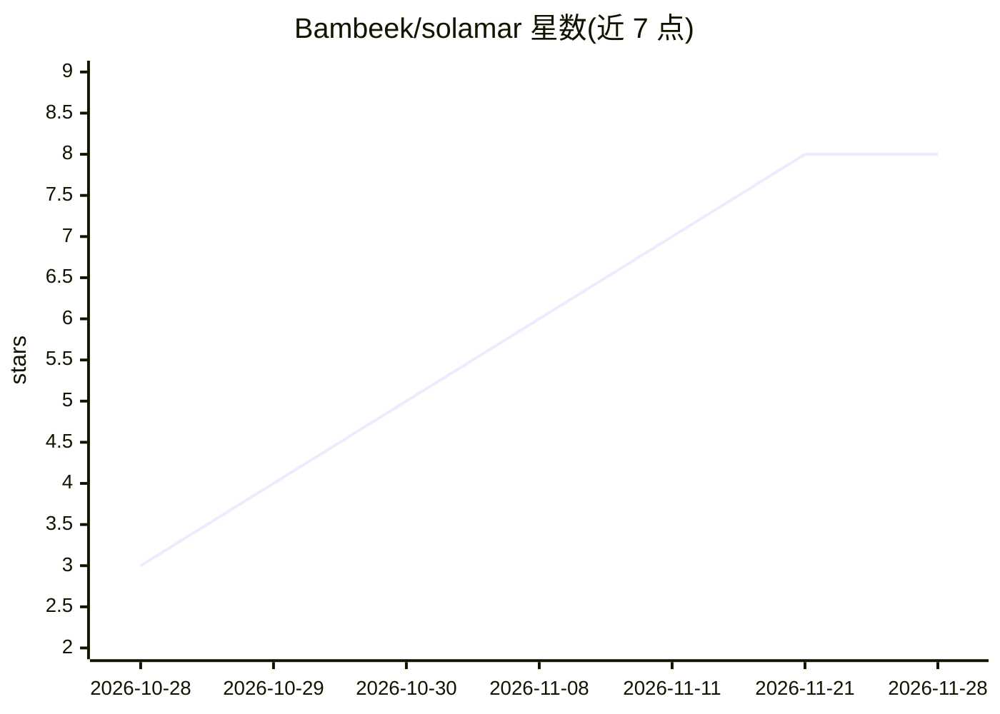

# Bambeek/solamar

⭐ 8 · TypeScript · GPL-3.0 · 推送 2026-11-05 · [GitHub](https://github.com/Bambeek/solamar) · [官网](https://solamar.app) · 个人维护

**开源浏览器：继承 Arc 空间管理，内置可选 AI 代理**

基于 Electron（castLabs 版，含 Widevine）与 Chromium 的开源浏览器，GPL-3.0、无账号、无遥测。核心功能：空间管理、垂直侧栏、一键导入 Arc 侧栏数据、内建广告拦截、Chrome 扩展支持、密码管理与私有空间。AI 功能默认关闭，用户可选择本地 Ollama 模型或自有 Anthropic API key 的 Claude；代理可在页面上执行读取、点击、填写表单等操作，支付/发送前等待用户确认。还可通过 MCP server 由 Claude Code 驱动。提供 Windows/macOS 安装包与源码构建。

## 筛选速览

| 维度 | 判定 | 备注 |
|---|---|---|
| AI 角色 | `ai-enhanced` | 去掉 AI 部分产品仍成立 |
| 许可风险 | `viral` | GPL-3.0 |
| 部署形态 | `library` | 以包/库形式分发 |
| 模型依赖 | local-ok | 支持本地模型 |
| 硬件要求 | — | 无带数字的原话,不猜 |
| 安装摩擦 | `low` | 无编译、无系统依赖或容器化 |
| 成熟度 | — | 结构信号不足 |

## 能力要点

- 一键读取 Arc 本地侧栏文件导入空间/固定标签/文件夹，不上传数据
- AI 默认关闭，可选 Ollama 本地模型或用户自有 Anthropic API key
- 本机 MCP server（127.0.0.1:47821 + token）供 Claude Code 驱动
- 代理操作前等待用户确认，不输入密码/卡号字段

## 适用场景

- 从 Arc 迁移并保留空间、侧栏与固定标签
- 在浏览器内让 AI 代为填表、整理标签、起草回复
- 在本地模型下让 AI 功能数据不出本机

## 场景标签

`浏览器自动化` · 领域:效率与自动化

## 证据(README 行号)

> L1: Solamar, the open-source browser after Arc: spaces, ad blocking and AI built in, with Arc import, an AI agent and Cl
> L45: ## AI, only if you want it

## 星数曲线

2026-10-28 3 → 2026-11-28 8（+5）

---
*卡片 v1 · prompt 1.4 · 生成 2026-11-20 · 置信度 high · 依据 README sha `820a0abea6f3` · [字段定义](../../DATASET.md)*
