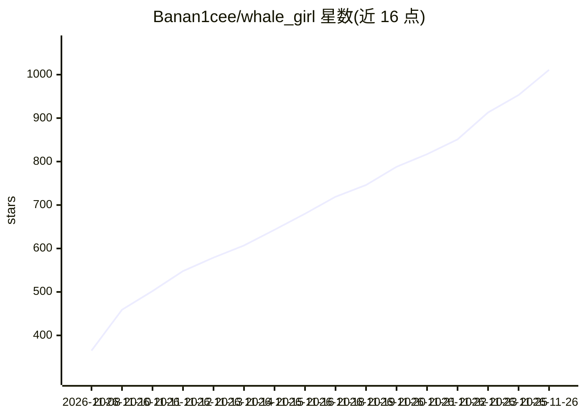

# Banan1cee/whale_girl

⭐ 1,011 · JavaScript · AGPL-3.0 · 推送 2026-11-25 · [GitHub](https://github.com/Banan1cee/whale_girl) · [官网](https://github.com/Banan1cee/whale_gril) · 个人维护 · 中文 README

**让 DeepSeek 等模型用你的微信账号群聊陪聊的 Windows 桌面应用**

本地优先的微信 AI 陪聊应用：通过 Windows UI 自动化桥接微信 4.x，在群聊中回复 @提及、记录私聊事实并压缩历史，可发表情包、语音回复、每日 Markdown 日记、朋友圈读取与网页搜索。模型侧支持 DeepSeek、智谱 GLM、SiliconFlow、Qwen、豆包及任意 OpenAI 兼容端点，可选 Ollama 本地服务。一切由 WPF 启动器 WhaleLauncher.exe 控制，安装包内置 Node.js、Python 3.12 与 .NET 10 运行时；需管理员权限且可能违反微信服务条款，需 ASCII 路径安装。

## 筛选速览

| 维度 | 判定 | 备注 |
|---|---|---|
| AI 角色 | `ai-native` | 本体是模型或模型工具 |
| 许可风险 | `dual` | AGPL-3.0 |
| 部署形态 | `desktop` | 安装包/桌面程序 |
| 模型依赖 | local-ok | 支持本地模型 |
| 硬件要求 | — | 无带数字的原话,不猜 |
| 安装摩擦 | `medium` | 含编译或系统依赖之一 |
| 成熟度 | — | 结构信号不足 |

## 能力要点

- UI 自动化桥接微信 4.x，不注入代码、不抢焦点
- 记忆系统：私聊事实记录与群聊历史压缩
- 表情包/语音/日记/朋友圈/搜索等扩展功能
- 单一 WPF 启动器管理启停、配置与诊断

## 适用场景

- 让 AI 用微信小号在群里陪聊
- 给 AI 陪聊角色配置人设与记忆
- 本地数据优先地运行微信 AI 群友

## 场景标签

`聊天机器人` · 领域:对话与助手

## 证据(README 行号)

> L13: A local-first AI companion for WeChat. She replies in group chats, remembers what people tell her, and can also sen
> L32: - One model API key: DeepSeek, Zhipu GLM, SiliconFlow, Qwen, Doubao, OpenCode, or any OpenAI-compatible endpoint

## 星数曲线

2026-11-08 365 → 2026-11-26 1,011（+646）

---
*卡片 v1 · prompt 1.4 · 生成 2026-11-17 · 置信度 mid · 依据 README sha `45ae850a7ff1` · [字段定义](../../DATASET.md)*
