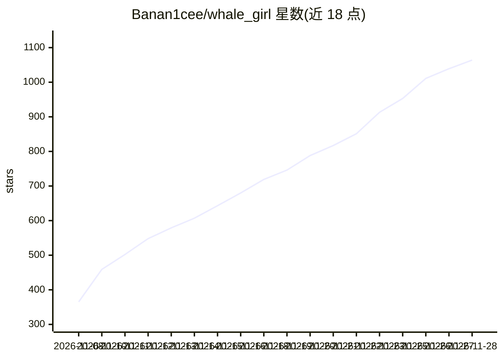

# Banan1cee/whale_girl

⭐ 1,064 · JavaScript · AGPL-3.0 · 推送 2026-11-27 · [GitHub](https://github.com/Banan1cee/whale_girl) · [官网](https://github.com/Banan1cee/whale_gril) · 个人维护 · 中文 README

**让 DeepSeek/Qwen 用你的 Windows 微信账号自动陪聊的桌面机器人**

本地运行的微信 AI 陪伴机器人：通过 UI 自动化桥接微信 4.x 桌面客户端，在群聊/私聊中回复 @ 和名字触发，支持记忆事实、压缩历史、表情包、朋友圈读取、Markdown 日记、语音转写与语音回复、搜索热榜、群管理。Windows 启动器 WhaleLauncher.exe 集中启停配置诊断；安装包捆绑 Node.js、Python 3.12 与 .NET 10 运行时，API 仅绑定本地 8787 端口。README 提示可能违反微信服务条款，需自担风险。

## 筛选速览

| 维度 | 判定 | 备注 |
|---|---|---|
| AI 角色 | `ai-native` | 本体是模型或模型工具 |
| 许可风险 | `dual` | AGPL-3.0 |
| 部署形态 | `desktop` | 安装包/桌面程序 |
| 模型依赖 | local-ok | 支持本地模型 |
| 硬件要求 | — | 无带数字的原话,不猜 |
| 安装摩擦 | `medium` | 含编译或系统依赖之一 |
| 成熟度 | — | 结构信号不足 |

## 能力要点

- 通过 UIA 自动化收发微信消息，无需注入或修改微信
- 记忆、人设、日记、表情包、语音收发、搜索等一组陪伴功能
- 单一 Windows 启动器完成启停、配置、诊断与更新校验（SHA256）
- 支持 DeepSeek/GLM/SiliconFlow/Qwen/Doubao 等 OpenAI 兼容端点及本地 Ollama

## 适用场景

- 在微信群中让 AI 以固定人设陪聊
- 让 AI 记录并回忆私聊中的主人信息
- 用远程控制台通过 Tailscale 在手机上管理机器人

## 场景标签

`聊天机器人` · 领域:对话与助手

## 证据(README 行号)

> L13: A local-first AI companion for WeChat. She replies in group chats, remembers what people tell her, and can also sen
> L32: - One model API key: DeepSeek, Zhipu GLM, SiliconFlow, Qwen, Doubao, OpenCode, or any OpenAI-compatible endpoint
> L129: - The bridge uses UI automation and reads the local WeChat database. It does not patch WeChat or inject code, but 

## 星数曲线

2026-11-08 365 → 2026-11-28 1,064（+699）

---
*卡片 v1 · prompt 1.4 · 生成 2026-11-28 · 置信度 mid · 依据 README sha `9510fe2c397a` · [字段定义](../../DATASET.md)*
