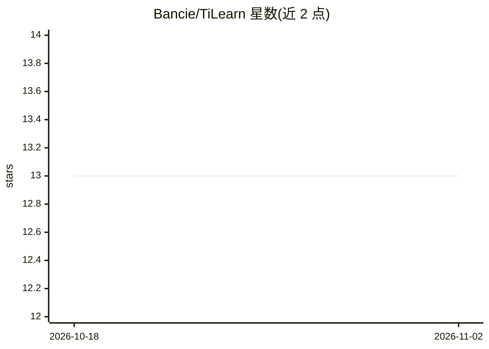

# Bancie/TiLearn

⭐ 13 · Python · MIT · 推送 2026-05-31 · [GitHub](https://github.com/Bancie/TiLearn) · [官网](https://bancie.github.io/TiLearn/) · 个人维护

**用 ML/DL 做机器调度与时间管理的 Python 库**

TiLearn 是一个将机器学习与深度学习技术应用于机器调度（Machine Scheduling）和时间管理（Optimal Processing）的 Python 库。面向需要优化排产、减少停机与提升吞吐的场景，目标功能包括最优调度算法、基于预测模型的设备故障预判，以及用深度学习辅助资源分配与时间管理。通过 PyPI 发布（pip install TiLearn），提供文档站点与教程，并鼓励贡献者参与算法开发、数据预处理与模型训练评估。

## 筛选速览

| 维度 | 判定 | 备注 |
|---|---|---|
| AI 角色 | `ai-native` | 本体是模型或模型工具 |
| 许可风险 | `permissive` | MIT |
| 部署形态 | `library` | 以包/库形式分发 |
| 模型依赖 | — | README 未给出锁定关系 |
| 硬件要求 | — | 无带数字的原话,不猜 |
| 安装摩擦 | `low` | 无编译、无系统依赖或容器化 |
| 成熟度 | — | 结构信号不足 |

## 能力要点

- 将 ML/DL 技术应用于机器调度问题
- 目标覆盖最优调度、预测性维护、时间管理
- pip 安装，配套文档站点与教程

## 适用场景

- 为车间机器生成优化调度方案
- 训练预测模型预判设备故障
- 用深度学习辅助团队资源分配与时间管理

## 场景标签

 · 领域:运筹优化/机器学习

## 证据(README 行号)

> L11: Welcome to our open-source project focused on applying **Machine Learning (ML)** and **Deep Learning (DL)** techniq
> L34: - **Optimized Scheduling**: Develop algorithms that can create optimal schedules for machines, minimizing downtime 
> L35: - **Predictive Maintenance**: Implement predictive models to foresee and mitigate potential machine failures, ensur

## 星数曲线

2026-10-18 13 → 2026-11-02 13（+0）

---
*卡片 v1 · prompt 1.4 · 生成 2026-10-31 · 置信度 mid · 依据 README sha `75de083e2815` · [字段定义](../../DATASET.md)*
