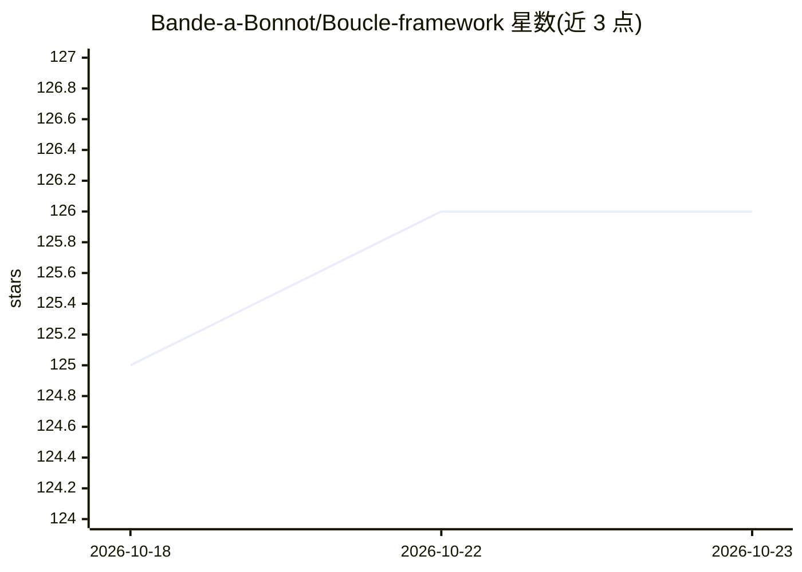

# Bande-a-Bonnot/Boucle-framework

⭐ 126 · Shell · MIT · 推送 2026-09-25 · [GitHub](https://github.com/Bande-a-Bonnot/Boucle-framework) · [官网](https://framework.boucle.sh/) · 个人维护

**Claude Code 安全钩子与审计工具集，拦截危险命令操作**

面向 Claude Code 用户的安全工具集：提供 7 个独立钩子（bash-guard、git-safe、file-guard 等）与 enforce-hooks 策略钩子，在工具调用前拦截危险 shell 命令、破坏性 git 操作和敏感文件访问；配套 safety-check 审计脚本对现有配置打 A-F 评分并用构造的 JSON 载荷实测钩子是否真正阻断，支持 CI 严格模式。通过 curl 安装脚本部署到 ~/.claude/，macOS/Linux 需 bash、python3、jq，Windows 原生 PowerShell 7 脚本另附 1,900+ 测试。

## 筛选速览

| 维度 | 判定 | 备注 |
|---|---|---|
| AI 角色 | `ai-ecosystem` | LLM/agent 周边工具 |
| 许可风险 | `permissive` | MIT |
| 部署形态 | `None` |  |
| 模型依赖 | — | README 未给出锁定关系 |
| 硬件要求 | — | 无带数字的原话,不猜 |
| 安装摩擦 | `medium` | 含编译或系统依赖之一 |
| 成熟度 | — | 结构信号不足 |

## 能力要点

- 7 个独立钩子 + enforce-hooks 钩子，覆盖 CLAUDE.md 政策强制
- safety-check 审计对配置打 A-F 分并以 --verify 实测钩子阻断效果
- 1,900+ 测试与 CI 严格模式（FAIL-OPEN 即失败）
- macOS/Linux 与 Windows 原生 PowerShell 7 双平台安装路径

## 适用场景

- 给 Claude Code 会话加上危险命令与破坏性 git 操作的拦截
- 审计现有 Claude Code 安全配置并实测钩子是否生效
- 在 CI 中以严格模式检查钩子健康状态

## 场景标签

`网络安全` · 领域:学习与行业

## 证据(README 行号)

> L12: Claude Code's CLAUDE.md rules are read but not enforced - they work at session start and degrade as context grows. 
> L80: Checks hook installation, hook health (missing/non-executable scripts), live verification (builds Claude-style JSON

## 星数曲线

2026-10-18 125 → 2026-10-23 126（+1）

---
*卡片 v1 · prompt 1.4 · 生成 2026-10-23 · 置信度 high · 依据 README sha `7fbbedbc7071` · [字段定义](../../DATASET.md)*
