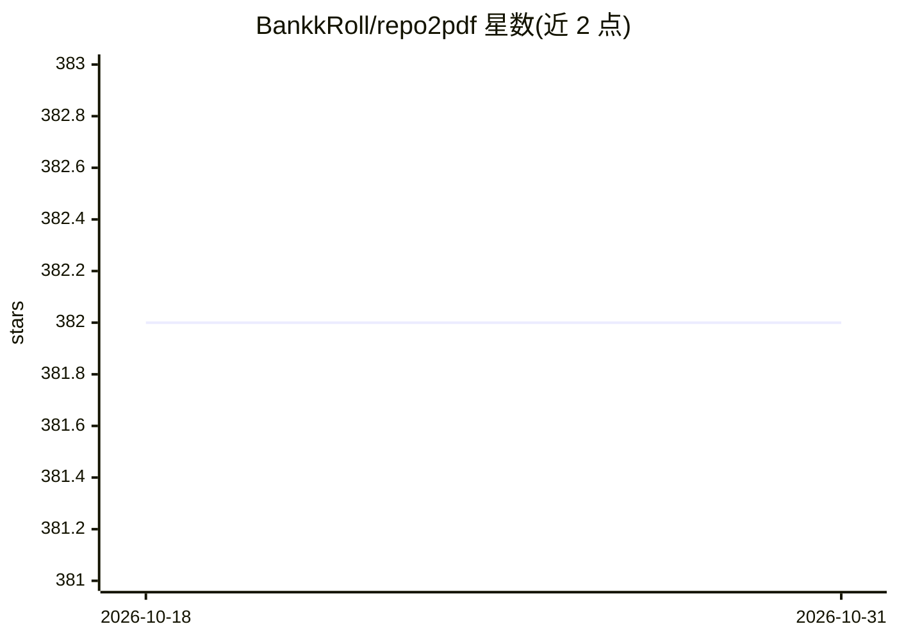

# BankkRoll/repo2pdf

⭐ 382 · TypeScript · MIT · 推送 2026-10-19 · [GitHub](https://github.com/BankkRoll/repo2pdf) · [官网](https://repo2pdf.vercel.app/) · 个人维护

**把 GitHub 仓库克隆并转换为格式化 PDF 的 CLI 工具**

Node.js 命令行工具：克隆或读取本地仓库，解析文本类代码文件并生成 PDF，支持添加行号、页码、高亮、去除注释与空行、单文件或多 PDF 输出等选项；自动忽略图片等二进制文件，可通过 repo2pdf.ignore 自定义忽略列表。用途包括教学、代码评审、离线参考、归档及 AI 训练与文档嵌入的语料准备。通过 npx 直接运行或克隆源码构建，需 Node>18 与 git，另提供网页版。

## 筛选速览

| 维度 | 判定 | 备注 |
|---|---|---|
| AI 角色 | `ai-ecosystem` | LLM/agent 周边工具 |
| 许可风险 | `permissive` | MIT |
| 部署形态 | `library` | 以包/库形式分发 |
| 模型依赖 | — | README 未给出锁定关系 |
| 硬件要求 | — | 无带数字的原话,不猜 |
| 安装摩擦 | `low` | 无编译、无系统依赖或容器化 |
| 成熟度 | — | 结构信号不足 |

## 能力要点

- 克隆 GitHub 仓库或读取本地仓库并生成 PDF
- 行号/页码/高亮/去注释/去空行等输出选项
- repo2pdf.ignore 文件自定义忽略文件与扩展名
- 支持单 PDF 或每文件一个 PDF 两种输出模式

## 适用场景

- 把整个代码库转成 PDF 用于教学或代码评审
- 离线阅读或归档仓库内容
- 为 AI 训练或文档嵌入准备文本语料

## 场景标签

 · 领域:开发者工具/文档处理

## 证据(README 行号)

> L16: repo2pdf is an innovative and versatile tool designed to seamlessly transform GitHub repositories into well-formatt

## 星数曲线

2026-10-18 382 → 2026-10-31 382（+0）

---
*卡片 v1 · prompt 1.4 · 生成 2026-10-22 · 置信度 low · 依据 README sha `5c19b0dd56bb` · [字段定义](../../DATASET.md)*
