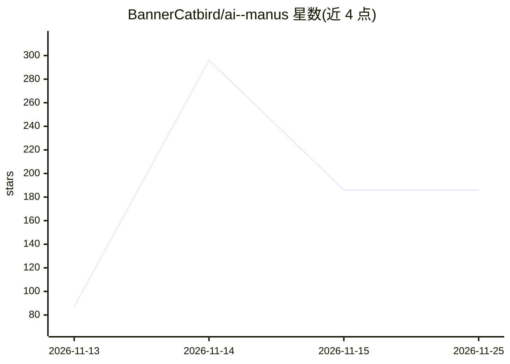

# BannerCatbird/ai--manus

⭐ 186 · Apache-2.0 · 推送 2026-11-15 · [GitHub](https://github.com/BannerCatbird/ai--manus) · 个人维护

**自主 AI Agent：代用户执行代码与控制浏览器完成多步任务**

Manus 是面向家庭、学习与轻量办公场景的自主 AI Agent：用户以自然语言下达指令，代理自行编写并执行脚本、打开网页、填写表单、抓取信息并完成多步任务，可在脚本与浏览器操作之间衔接流程。README 描述其无需编程背景即可使用，支持后台常驻与会话间保持一致的工作模式。兼容性表列出最低配置（双核 CPU、4 GB 内存）。README 未提供安装命令、下载渠道细节或技术实现说明，仅含宣传式功能描述与使用建议。

## 筛选速览

| 维度 | 判定 | 备注 |
|---|---|---|
| AI 角色 | `ai-native` | 本体是模型或模型工具 |
| 许可风险 | `permissive` | Apache-2.0 |
| 部署形态 | `None` |  |
| 模型依赖 | — | README 未给出锁定关系 |
| 硬件要求 | — | 无带数字的原话,不猜 |
| 安装摩擦 | `low` | 无编译、无系统依赖或容器化 |
| 成熟度 | — | 结构信号不足 |

## 能力要点

- 代理自主编写并执行代码完成多步任务
- 浏览器控制：导航网页、填表、采集信息
- 代码与浏览器操作可在同一任务流中衔接
- 面向非开发者，无需编程背景

## 适用场景

- 让学生整理研究笔记、运行小脚本
- 让代理代替人工浏览多个网页并汇总信息
- 将日常重复性小事（查页面、整理文件）委托给后台代理

## 场景标签

`浏览器自动化` · 领域:效率与自动化

## 证据(README 行号)

> L10: - **Autonomous Code Execution:** Manus AI agent runs code on its own to complete tasks, so you can focus on decisio
> L18: Manus is an autonomous AI agent designed to run code and control a browser on your behalf. Instead of acting like a

## 星数曲线

2026-11-13 87 → 2026-11-25 186（+99）

---
*卡片 v1 · prompt 1.4 · 生成 2026-11-17 · 置信度 low · 依据 README sha `0f78ee3a5dd2` · [字段定义](../../DATASET.md)*
