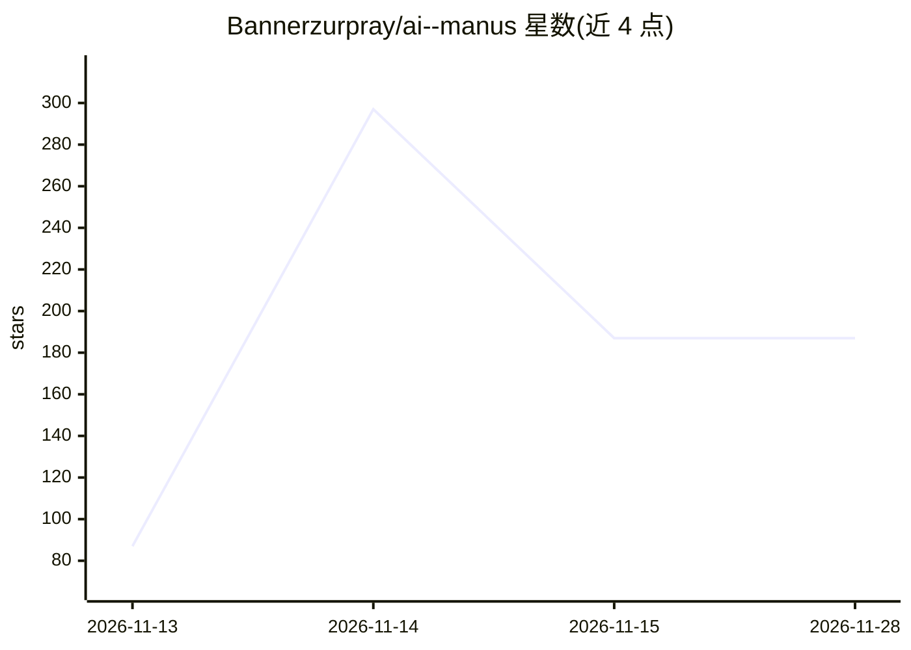

# Bannerzurpray/ai--manus

⭐ 187 · Apache-2.0 · 推送 2026-11-15 · [GitHub](https://github.com/Bannerzurpray/ai--manus) · 个人维护

**面向日常任务的自主 AI Agent：自行运行代码并控制浏览器**

自述为运行代码并控制浏览器的自主 AI 代理：用户以自然语言下达指令，agent 编写并执行脚本、打开网页、与页面元素交互、完成多步骤任务，可在后台长期驻留。README 将其定位为面向家庭、学习与轻量工作的个人助理，而非企业平台。文档仅给出硬件兼容表（最低 4GB 内存）与使用步骤描述，未提供任何安装命令、源码路径或 API 接入方式，代码与模型来源无法从 README 验证。

## 筛选速览

| 维度 | 判定 | 备注 |
|---|---|---|
| AI 角色 | `ai-native` | 本体是模型或模型工具 |
| 许可风险 | `permissive` | Apache-2.0 |
| 部署形态 | `None` |  |
| 模型依赖 | — | README 未给出锁定关系 |
| 硬件要求 | — | 无带数字的原话,不猜 |
| 安装摩擦 | `low` | 无编译、无系统依赖或容器化 |
| 成熟度 | — | 结构信号不足 |

## 能力要点

- 自主编写并执行代码完成多步骤任务
- 浏览器控制：导航网页、填表、采集信息
- 代码与浏览器操作在同一流程内衔接
- 面向非开发者用户，强调小规模日常场景

## 适用场景

- 让 agent 代为完成网页查资料、填表等重复操作
- 学习中整理研究笔记、运行小脚本
- 远程工作中跨多个页面收集信息并汇总

## 场景标签

`AI 助手` `浏览器自动化` `编码 Agent` · 领域:效率与自动化

## 证据(README 行号)

> L18: Manus is an autonomous AI agent designed to run code and control a browser on your behalf. Instead of acting like a
> L22: Manus is not a heavy studio suite or a complex enterprise platform. It is a focused helper built for home, study, a

## 星数曲线

2026-11-13 87 → 2026-11-28 187（+100）

---
*卡片 v1 · prompt 1.4 · 生成 2026-11-17 · 置信度 mid · 依据 README sha `0f78ee3a5dd2` · [字段定义](../../DATASET.md)*
