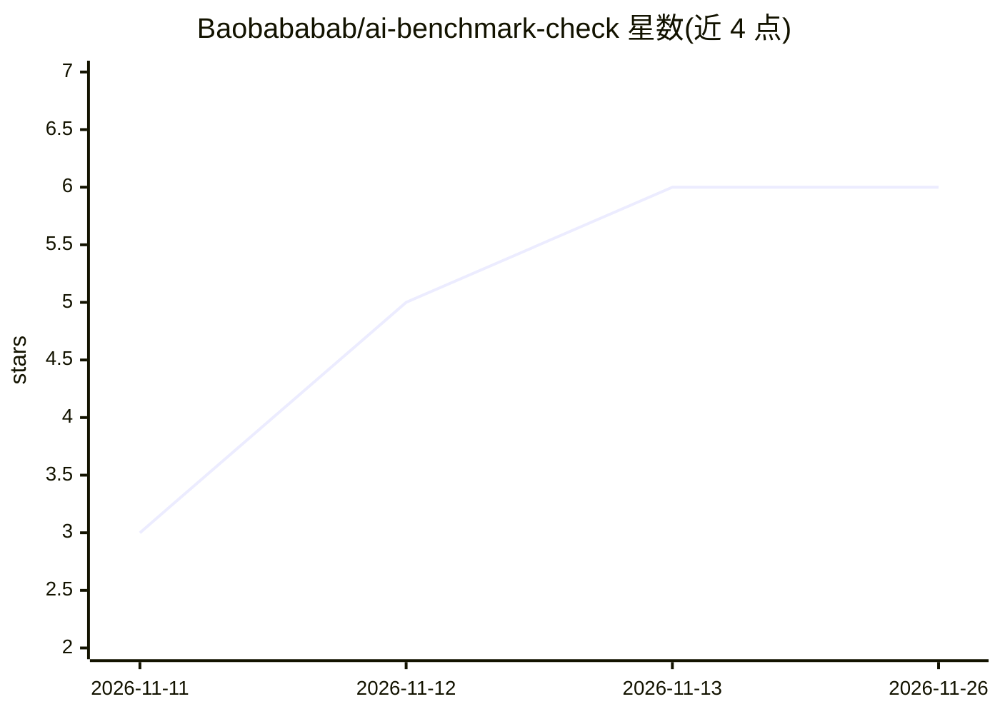

# Baobababab/ai-benchmark-check

⭐ 6 · Python · MIT · 推送 2026-11-25 · [GitHub](https://github.com/Baobababab/ai-benchmark-check) · 个人维护

**基于公开榜单与价格推荐性价比 AI 模型的命令行工具**

从 LMArena、Epoch AI 与 models.dev 三类公开数据源读取各基准分数、不确定区间与价格，用 95% 置信区间的统计并列规则找出与最强模型打平但最便宜的模型。纯 Python 标准库实现，无需 API key，data/ 目录附带每日更新的数据快照；可选运行 fetch.py 自行刷新数据，也可在 Claude Code 中通过 skill 查询。作者自述为个人小项目。

## 筛选速览

| 维度 | 判定 | 备注 |
|---|---|---|
| AI 角色 | `ai-ecosystem` | LLM/agent 周边工具 |
| 许可风险 | `permissive` | MIT |
| 部署形态 | `library` | 以包/库形式分发 |
| 模型依赖 | — | README 未给出锁定关系 |
| 硬件要求 | — | 无带数字的原话,不猜 |
| 安装摩擦 | `low` | 无编译、无系统依赖或容器化 |
| 成熟度 | `idea` | |

## 能力要点

- 按 95% 置信区间判定与最优模型统计并列，再选其中最便宜者
- 每日由 GitHub Actions 自动拉取 LMArena、Epoch AI、models.dev 数据
- 无 API key、无需安装依赖，仅用 Python 标准库读取本地 data/ 文件
- 支持 --open 仅查开源权重模型、--top N 查看排名、--model 查单个模型

## 适用场景

- 选模型前先查哪个基准下最便宜的打平模型
- 只考虑开源权重模型时做对比筛选
- 在 Claude Code 里直接问模型选择问题

## 场景标签

 · 领域:LLM 基础设施/模型选型

## 证据(README 行号)

> L5: Answers questions about current AI models from open leaderboards and public prices: which model is strongest, which 
> L79: - **Processing:** for one benchmark, each model counts once, with its best setting (High, Max, Thinking...); settin
> L83: A GitHub Actions job is scheduled to run `fetch.py` every day and commit the new data. If a source is empty, stale 

## 星数曲线

2026-11-11 3 → 2026-11-26 6（+3）

---
*卡片 v1 · prompt 1.4 · 生成 2026-11-20 · 置信度 mid · 依据 README sha `3fa2a2196c2f` · [字段定义](../../DATASET.md)*
