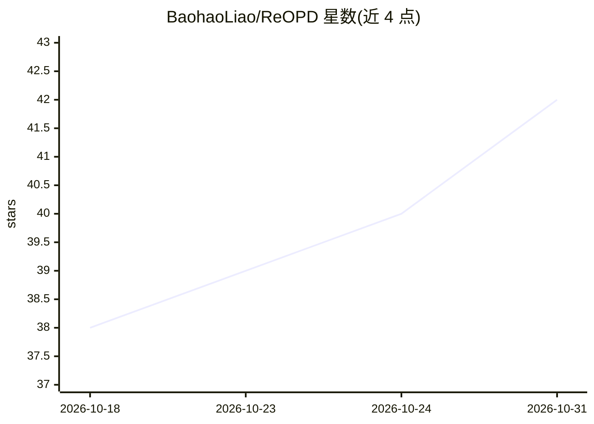

# BaohaoLiao/ReOPD

⭐ 42 · Python · MIT · 推送 2026-07-26 · [GitHub](https://github.com/BaohaoLiao/ReOPD) · [官网](https://baohaoliao.github.io/ReOPD/) · 个人维护

**免环境交互的 agent 蒸馏训练框架：重放教师前缀训练学生**

面向 LLM agent 的研究代码：将教师 agent 蒸馏到学生模型，训练期间学生不与环境交互，而是基于教师 RL 过程中免费收集的轨迹前缀池行动，由教师提供逐步监督；每样本单轮、零工具调用，文档称 rollout 提速 4–9 倍。基于 slime 训练框架与 SGLang 推理服务构建，覆盖 Math（ReTool）与 Search（Search-R1）环境，提供四阶段脚本（冷启动 SFT、教师 GRPO、ReOPD 蒸馏、OPD 基线）及 Hugging Face 上的检查点与前缀池数据集。需要多 GPU 环境。

## 筛选速览

| 维度 | 判定 | 备注 |
|---|---|---|
| AI 角色 | `ai-ecosystem` | LLM/agent 周边工具 |
| 许可风险 | `permissive` | MIT |
| 部署形态 | `library` | 以包/库形式分发 |
| 模型依赖 | — | README 未给出锁定关系 |
| 硬件要求 | — | 无带数字的原话,不猜 |
| 安装摩擦 | `medium` | 含编译或系统依赖之一 |
| 成熟度 | — | 结构信号不足 |

## 能力要点

- 学生训练阶段零环境交互、零工具调用，文档称 rollout 提速 4–9 倍
- 教师 RL rollout 免费转化为前缀池，位置采样 p_t ∝ κ^t 缓解分布偏移
- 四阶段训练脚本：冷启动 SFT / 教师 GRPO / ReOPD / OPD 基线
- 支持多环境（Math、Search）联合蒸馏，检查点与前缀池已发布

## 适用场景

- 把大教师 agent 的工具调用能力蒸馏到小模型
- 复现或对比 on-policy distillation 与离线前缀重放方法
- 在无需保持环境在线的条件下做 agent 多环境训练

## 场景标签

`强化学习` `微调` · 领域:训练与推理

## 证据(README 行号)

> L3: ReOPD distills a teacher agent into a student **without environment interaction during student training**: the stude
> L18: Fully online OPD (top) re-rolls the student through a live environment every update and queries the teacher at each

## 星数曲线

2026-10-18 38 → 2026-10-31 42（+4）

---
*卡片 v1 · prompt 1.4 · 生成 2026-10-25 · 置信度 high · 依据 README sha `8ca35e2722e1` · [字段定义](../../DATASET.md)*
