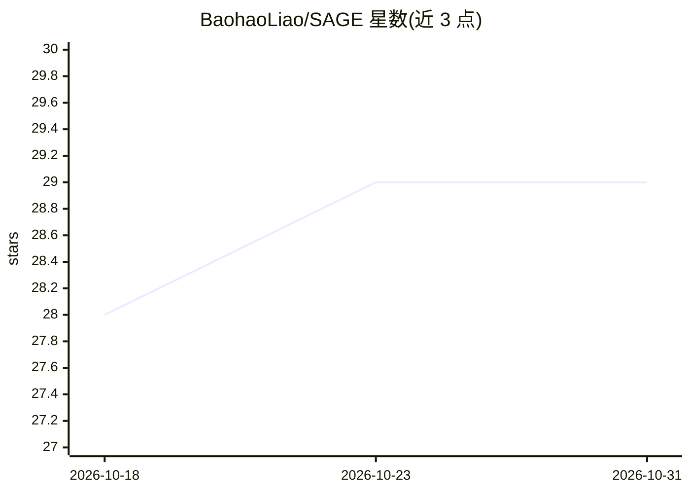

# BaohaoLiao/SAGE

⭐ 29 · Python · Apache-2.0 · 推送 2026-03-28 · [GitHub](https://github.com/BaohaoLiao/SAGE) · [官网](https://arxiv.org/abs/2602.03143) · 个人维护

**论文复现代码：LLM 自生成提示改善 GRPO 强化学习训练**

SAGE（Self-Hinting）方法的开源实现：在 GRPO 强化学习中，当困难 prompt 采样不到正确轨迹时，由 LLM 从参考答案自生成提示，与原 prompt 拼接后再采样，以避免 advantage collapse、提高困难 prompt 利用率并促进探索。代码基于 verl 训练框架构建，用 vllm 做采样、oat 做回答评分；提供 SAGE 与 SAGE-light 训练脚本、GRPO/LUFFY/SFT/Scaf-GRPO 基线及 6 个 Hugging Face 已训练模型。在 NVIDIA B200 上测试，旧 GPU 需调整 CUDA 版本。

## 筛选速览

| 维度 | 判定 | 备注 |
|---|---|---|
| AI 角色 | `ai-ecosystem` | LLM/agent 周边工具 |
| 许可风险 | `permissive` | Apache-2.0 |
| 部署形态 | `library` | 以包/库形式分发 |
| 模型依赖 | local-ok | 支持本地模型 |
| 硬件要求 | — | 无带数字的原话,不猜 |
| 安装摩擦 | `medium` | 含编译或系统依赖之一 |
| 成熟度 | — | 结构信号不足 |

## 能力要点

- LLM 自生成提示机制，困难 prompt 利用率提升 10%
- 基于 verl 框架，保留 GRPO 的 on-policy 性质
- 提供 SAGE/SAGE-light 训练脚本与 GRPO、LUFFY、Scaf-GRPO 等基线
- 发布 Llama-3.2-3B、Qwen2.5-7B、Qwen3-4B 等 6 个已训练模型

## 适用场景

- 复现论文中的 SAGE/SAGE-light 强化学习方法
- 在 GRPO 训练中提升困难 prompt 的采样成功率
- 下载作者发布的已训练模型做评估或对比

## 场景标签

`强化学习` · 领域:训练与推理

## 证据(README 行号)

> L5: When signal is lost for hard prompts during RL (all trajectories are wrong), the LLM self-generates a hint to help s
> L23: When an LLM can’t sample any correct trajectory for a hard prompt, the LLM self-generates a hint from the reference
> L149: Our code is based on verl for training, vllm for sampling, and oat for response grader. We really appreciate their

## 星数曲线

2026-10-18 28 → 2026-10-31 29（+1）

---
*卡片 v1 · prompt 1.4 · 生成 2026-10-26 · 置信度 mid · 依据 README sha `152026b45d6e` · [字段定义](../../DATASET.md)*
