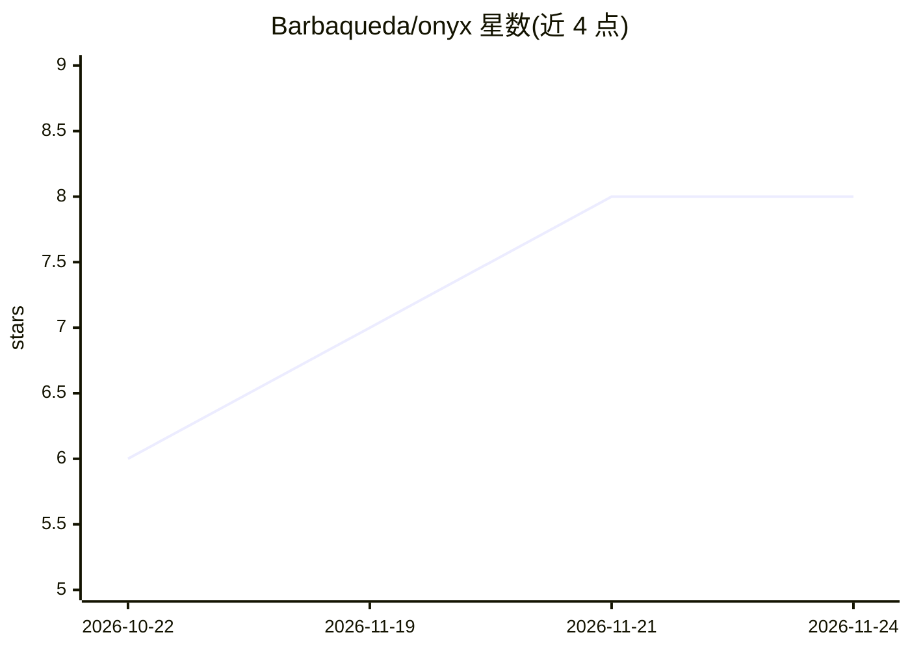

# Barbaqueda/onyx

⭐ 8 · JavaScript · NOASSERTION · 推送 2026-10-15 · [GitHub](https://github.com/Barbaqueda/onyx) · [官网](https://barbaqueda.github.io/onyx/) · 个人维护

**面向 Windows 用户的智能文件整理器与资源管理器**

Electron 构建的 Windows x64 桌面文件整理器：扫描文件夹后由 AI 或离线规则生成整理方案，用户逐项勾选确认后才执行移动，全程可一键撤销（日志回放，不覆盖已有文件）。整理之外还充当文件浏览器，提供标签（手动/自动/AI 读取文件名生成）、快速查找、保存的搜索、预览扩展和图形视图。个人使用免费，商用与再分发需许可；无需安装器与管理员权限，AI 部分可选安装 Ollama 在本机运行。

## 筛选速览

| 维度 | 判定 | 备注 |
|---|---|---|
| AI 角色 | `ai-enhanced` | 去掉 AI 部分产品仍成立 |
| 许可风险 | `none` | NOASSERTION |
| 部署形态 | `desktop` | 安装包/桌面程序 |
| 模型依赖 | local-ok | 支持本地模型 |
| 硬件要求 | — | 无带数字的原话,不猜 |
| 安装摩擦 | `low` | 无编译、无系统依赖或容器化 |
| 成熟度 | — | 结构信号不足 |

## 能力要点

- 整理方案需用户审阅确认后才移动文件，且全程可撤销
- AI 仅读取文件名生成 1-4 个标签并复用既有标签，可选 Ollama 本地运行
- 离线规则策略（关键词、系列检测、文件类型）无需 AI 即可整理
- 标签存于应用数据目录，不写入用户文件夹、不改动文件内容

## 适用场景

- 整理杂乱的下载文件夹且保留逐项否决权
- 给 Obsidian 库周边的文件打标签便于检索
- 断网环境下按离线规则整理文件
- 替代资源管理器做带标签与预览的文件浏览

## 场景标签

 · 领域:效率工具/文件管理

## 证据(README 行号)

> L1: Onyx: a smart file organizer for Windows
> L65:     B --> C["✦ Plan AI or offline rules"]
> L112: - **With AI.** One click and AI reads the names (never the contents) and adds 1 to 4 tags about topic, project or 

## 星数曲线

2026-10-22 6 → 2026-11-24 8（+2）

---
*卡片 v1 · prompt 1.4 · 生成 2026-11-20 · 置信度 mid · 依据 README sha `ce808ade2d2d` · [字段定义](../../DATASET.md)*
