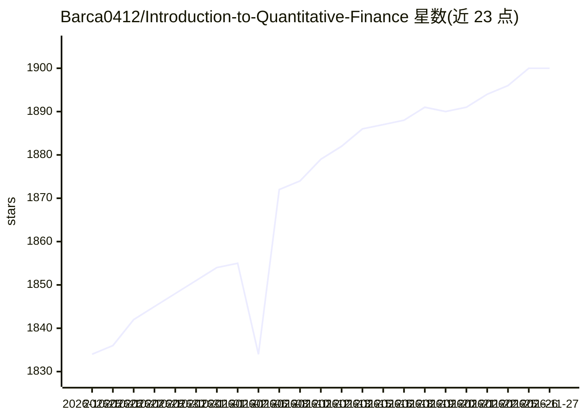

# Barca0412/Introduction-to-Quantitative-Finance

⭐ 1,900 · Python · MIT · 推送 2026-11-25 · [GitHub](https://github.com/Barca0412/Introduction-to-Quantitative-Finance) · [官网](https://quant.hfthnu.com/) · 组织维护 · 中文 README

**中文项目式量化金融教程与 AI×金融论文雷达知识库**

基于湖南大学《量化投资》课程整理的中文开源量化知识库，核心是项目式教程：每讲用免费数据完成一个具体研究任务（如 CAPM Beta 估计、价值/规模效应检验），附代码、样例数据与 AI 编程辅助提示词。另收录 194 份卖方金工研报、百余学术论文目录、开源项目与论坛清单；FinPaperRadar 每天抓取 arXiv 15 个分类的论文，用大模型打标签、写中文摘要并提供语义检索，数据以 Parquet 发布在 Hugging Face。讲义依赖的 CSMAR 数据库需高校或机构账号。

## 筛选速览

| 维度 | 判定 | 备注 |
|---|---|---|
| AI 角色 | `ai-knowledge` | 知识聚合/清单类 |
| 许可风险 | `permissive` | MIT |
| 部署形态 | `None` |  |
| 模型依赖 | — | README 未给出锁定关系 |
| 硬件要求 | — | 无带数字的原话,不猜 |
| 安装摩擦 | `low` | 无编译、无系统依赖或容器化 |
| 成熟度 | — | 结构信号不足 |

## 能力要点

- 项目式量化教程，每讲为完整实战项目并附 AI 编程辅助提示词
- FinPaperRadar 每日抓取 arXiv 论文，大模型打标签、写中文摘要、支持语义检索
- 收录 194 份卖方金工研报与百余学术论文目录
- 整理多因子、回测、组合优化、强化学习交易等开源项目清单

## 适用场景

- 跟着教程用免费数据完整走一遍数据、因子、回测、组合流程
- 查找量化金融方向的经典研报、论文与开源框架
- 追踪 AI×金融领域每天新发布的 arXiv 论文
- 高校课程或自学的量化投资入门参考资料

## 场景标签

`金融量化` `教程课程` `语义搜索` · 领域:知识与检索

## 证据(README 行号)

> L3: > 中文开源量化知识库：用免费数据一步步做完的**项目式量化教程**，配合概念知识库、研报与论文目录，以及每天更新的 **FinPaperRadar（AI × 金融论文雷达）**。
> L23: |教程|每一讲是一个完整小项目，附代码、样例数据和练习|
> L26: |论文雷达|每天抓取 arXiv 新论文，打标签、写中文摘要，支持语义检索|

## 星数曲线

2026-10-25 1,834 → 2026-11-27 1,900（+66）

---
*卡片 v1 · prompt 1.4 · 生成 2026-11-23 · 置信度 high · 依据 README sha `a0004dcc7327` · [字段定义](../../DATASET.md)*
