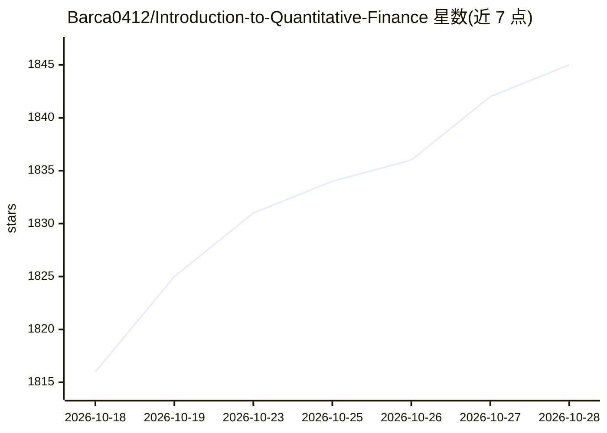

# Barca0412/Introduction-to-Quantitative-Finance

⭐ 1,845 · Python · MIT · 推送 2026-10-27 · [GitHub](https://github.com/Barca0412/Introduction-to-Quantitative-Finance) · [官网](https://barca0412.github.io/Introduction-to-Quantitative-Finance/) · 组织维护 · 中文 README

**面向量化学习者的中文知识库：教程、资源地图与 AI+金融论文雷达**

中文开源知识库，汇编三类内容：多因子股票量化投研框架教程（源自湖南大学金融科技协会 Quant Group 的研究内容）、量化数据/回测/因子挖掘/机器学习等公开资源地图，以及 AI + Finance arXiv Radar 子站——工作日自动抓取并索引相关论文（当前收录 24506 篇、聚焦 13723 篇），提供论文列表、趋势图、语义检索、机构筛选与标签聚合。文档站基于 VitePress 构建，数据管线位于 scripts/arxiv_radar/，可通过 npm run arxiv:update 刷新。部分资料整理仍在完善中。

## 筛选速览

| 维度 | 判定 | 备注 |
|---|---|---|
| AI 角色 | `ai-knowledge` | 知识聚合/清单类 |
| 许可风险 | `permissive` | MIT |
| 部署形态 | `None` |  |
| 模型依赖 | — | README 未给出锁定关系 |
| 硬件要求 | — | 无带数字的原话,不猜 |
| 安装摩擦 | `low` | 无编译、无系统依赖或容器化 |
| 成熟度 | — | 结构信号不足 |

## 能力要点

- 多因子量化投研框架教程与学习路线
- AI + Finance arXiv Radar：索引 24506 篇论文，支持语义检索与趋势/标签视图
- 覆盖数据源、回测框架、因子挖掘、强化学习交易、高频交易等类别的资源地图
- 收录国内量化论坛、课程与工具清单

## 适用场景

- 系统学习多因子量化投研框架与回测方法
- 跟踪 AI+金融方向的最新论文动态
- 查找量化数据源、回测框架与课程资料

## 场景标签

`金融量化` `教程课程` `科研工具` `精选清单` · 领域:学习与行业

## 证据(README 行号)

> L3: > 面向量化研究者与学习者的中文开源知识库：多因子投研框架、AI + Finance arXiv Radar，以及经过整理的工具、课程与研究资源。
> L17: - **多因子量化投研教程**：从研究框架到因子、回测与组合优化的学习路线。
> L18: - **AI + Finance arXiv Radar**：工作日自动抓取、聚类与检索相关论文，提供趋势与标签视图。

## 星数曲线

2026-10-18 1,816 → 2026-10-28 1,845（+29）

---
*卡片 v1 · prompt 1.4 · 生成 2026-10-21 · 置信度 high · 依据 README sha `4e815581e028` · [字段定义](../../DATASET.md)*
