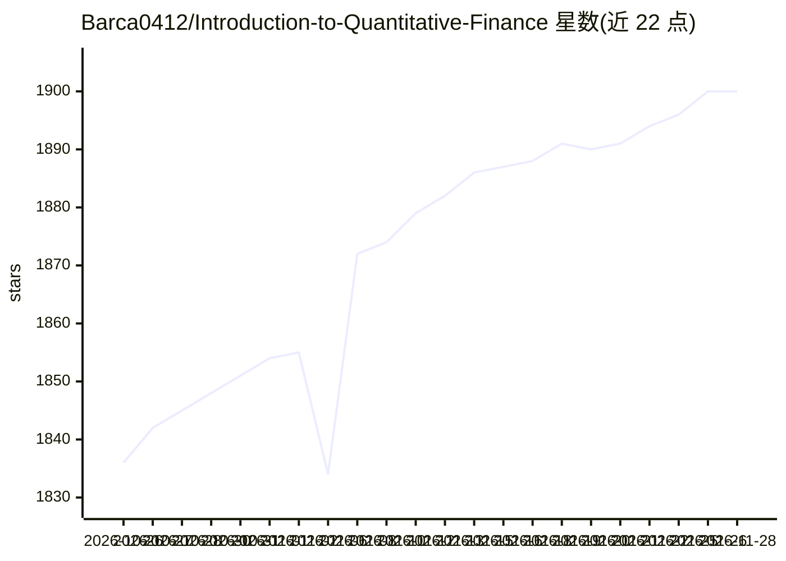

# Barca0412/Introduction-to-Quantitative-Finance

⭐ 1,900 · Python · MIT · 推送 2026-11-27 · [GitHub](https://github.com/Barca0412/Introduction-to-Quantitative-Finance) · [官网](https://quant.hfthnu.com/) · 组织维护 · 中文 README

**中文量化金融项目式教程与 AI×金融论文雷达知识库**

以项目式教程为核心的开源量化知识库：每讲用免费数据完成一个具体研究任务（如 CAPM Beta 估计、价值/规模效应检验），附代码、样例数据与 AI 编程参考提示词；配套概念知识库、194 份卖方研报与百余篇论文目录。FinPaperRadar 每天抓取 arXiv 15 个分类的新论文，用大模型打标签、写中文摘要，数据以 Parquet 发布在 Hugging Face，新增内容按 CC BY 4.0 授权。由湖南大学金融科技协会维护，讲义源自该校课程。

## 筛选速览

| 维度 | 判定 | 备注 |
|---|---|---|
| AI 角色 | `ai-knowledge` | 知识聚合/清单类 |
| 许可风险 | `permissive` | MIT |
| 部署形态 | `None` |  |
| 模型依赖 | — | README 未给出锁定关系 |
| 硬件要求 | — | 无带数字的原话,不猜 |
| 安装摩擦 | `low` | 无编译、无系统依赖或容器化 |
| 成熟度 | — | 结构信号不足 |

## 能力要点

- 项目式讲义：每讲附代码、样例数据、练习与 AI 编程提示词
- FinPaperRadar 每日抓取 arXiv 论文，大模型生成中文摘要与标签，支持语义检索
- 收录 194 份卖方金工研报与一百多篇学术论文目录
- 完整历史数据集发布于 Hugging Face 并留 GitHub Release 镜像

## 适用场景

- 按讲义一步步完成多因子量化研究全流程
- 跟踪 AI×金融方向的最新 arXiv 论文
- 查找卖方研报与学术论文作为研究参考

## 场景标签

`教程课程` `金融量化` `科研工具` · 领域:学习与行业

## 证据(README 行号)

> L3: > 中文开源量化知识库：用免费数据一步步做完的**项目式量化教程**，配合概念知识库、研报与论文目录，以及每天更新的 **FinPaperRadar（AI × 金融论文雷达）**。
> L19: 网上的量化资料很多，但大多只给概念或只给清单，初学者很难把"数据、因子、回测、组合"真正串起来做一遍。这个项目的核心是教程：每一讲用免费数据完成一个具体的研究任务，并说明结果怎么读、哪里容易出错。
> L26: |论文雷达|每天抓取 arXiv 新论文，打标签、写中文摘要，支持语义检索|

## 星数曲线

2026-10-26 1,836 → 2026-11-28 1,900（+64）

---
*卡片 v1 · prompt 1.4 · 生成 2026-11-28 · 置信度 high · 依据 README sha `27d323d2c04c` · [字段定义](../../DATASET.md)*
