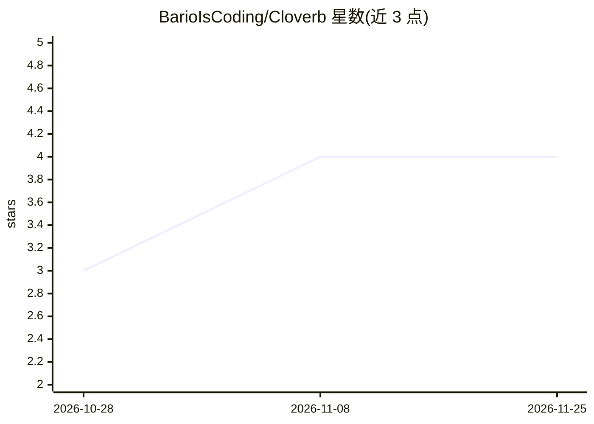

# BarioIsCoding/Cloverb

⭐ 4 · Python · MIT · 推送 2026-10-24 · [GitHub](https://github.com/BarioIsCoding/Cloverb) · 个人维护

**预测特定棋力人类走法的国际象棋引擎**

以方格序列 transformer 为核心的国际象棋引擎，重建自 Chessformer/Maia-3，输入玩家 Elo、时间控制、剩余时间及最近 64 步走法，预测该棋力的玩家会走的棋。提供两个运行形态：无需 Python/PyTorch 的独立 C 引擎（UCI 协议，AMX/AVX-512/AVX2）和带预测思考时间功能的 Python 引擎。全部训练、基准与评估在 4 核 CPU（无 GPU）上完成；附带 Maia-3 复现基准、训练/评估工具链与蒸馏 teacher 实现。

## 筛选速览

| 维度 | 判定 | 备注 |
|---|---|---|
| AI 角色 | `ai-native` | 本体是模型或模型工具 |
| 许可风险 | `permissive` | MIT |
| 部署形态 | `library` | 以包/库形式分发 |
| 模型依赖 | — | README 未给出锁定关系 |
| 硬件要求 | — | 无带数字的原话,不猜 |
| 安装摩擦 | `low` | 无编译、无系统依赖或容器化 |
| 成熟度 | — | 结构信号不足 |

## 能力要点

- 输入玩家 Elo 与时钟状态，输出人类风格的走法
- 独立 C 引擎无需 Python/PyTorch，x86-64/ARM CPU 可运行
- CPU-only 完成训练与评估（AMX bf16）
- 复现 Maia-3 基准并发布对比结果

## 适用场景

- 在 UCI 界面中以指定 Elo 棋力的对手下棋
- 研究人类走法预测模型的训练与评估流程
- 无 GPU 环境下运行 transformer 模型推理

## 场景标签

`模型训练` `模型评测` · 领域:评测与运维

## 证据(README 行号)

> L3: Cloverb is a human-like chess engine: a square-token transformer that predicts the move a human
> L34: Standalone C engine (no Python or PyTorch). It runs on any x86-64 or ARM CPU: `-march=native` selects AMX bf16 tile

## 星数曲线

2026-10-28 3 → 2026-11-25 4（+1）

---
*卡片 v1 · prompt 1.4 · 生成 2026-11-22 · 置信度 mid · 依据 README sha `76dd5cae957d` · [字段定义](../../DATASET.md)*
