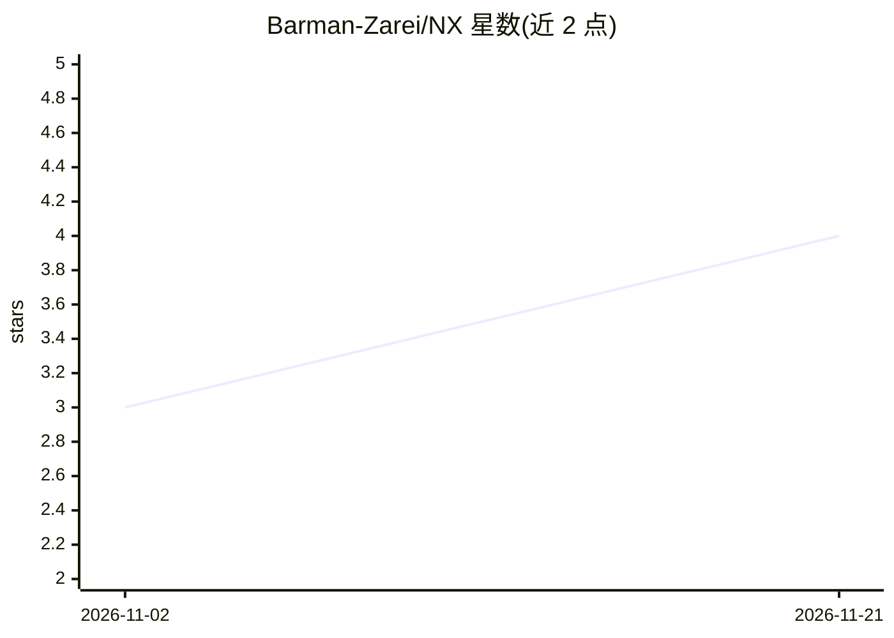

# Barman-Zarei/NX

⭐ 4 · Python · 推送 2026-11-14 · [GitHub](https://github.com/Barman-Zarei/NX) · 个人维护

**基于 Ubuntu 的实验性 Linux 发行版，规划集成 Brok AI 层**

一个基于 Ubuntu 的独立 Linux 发行版项目，目标是以模块化方式构建操作系统基础，并规划围绕 Brok 的 AI 集成层。仓库包含核心系统组件、ISO 构建脚本、虚拟机启动测试工具、安装与桌面相关代码、Windows 配套校验工具及文档。项目处于实验阶段，安装仅经 VM 测试，明确声明未达到生产可用；各组件的实际状态需依据代码、文档与测试结果评估。

## 筛选速览

| 维度 | 判定 | 备注 |
|---|---|---|
| AI 角色 | `ai-enhanced` | 去掉 AI 部分产品仍成立 |
| 许可风险 | `none` | — |
| 部署形态 | `None` |  |
| 模型依赖 | — | README 未给出锁定关系 |
| 硬件要求 | — | 无带数字的原话,不猜 |
| 安装摩擦 | `low` | 无编译、无系统依赖或容器化 |
| 成熟度 | `idea` | |

## 能力要点

- 提供 ISO 构建脚本与 QEMU 启动测试工作流（支持 KVM/TCG）
- 规划围绕 Brok 的 AI 集成层（尚未实现，README 明确区分计划与现状）
- 面向旧系统的 Legacy 兼容性目标
- 附 Windows 7+ 校验工具（Qt 5.15 / PySide2 / Python 3.8）

## 适用场景

- 在虚拟机中实验性构建并启动该发行版 ISO
- 参与操作系统构建与兼容性测试
- 关注 AI 与操作系统集成的开发者跟踪规划

## 场景标签

 · 领域:操作系统/Linux 发行版

## 证据(README 行号)

> L7: **An independent Ubuntu-based Linux distribution exploring a modular operating-system foundation and planned AI inte
> L26: NX OS is an independent Linux distribution based on Ubuntu. Its long-term goal is to explore a more integrated comp
> L50: |Brok integration|Planned; not to be treated as implemented without code and tests|

## 星数曲线

2026-11-02 3 → 2026-11-21 4（+1）

---
*卡片 v1 · prompt 1.4 · 生成 2026-11-21 · 置信度 mid · 依据 README sha `9caec0bc8712` · [字段定义](../../DATASET.md)*
