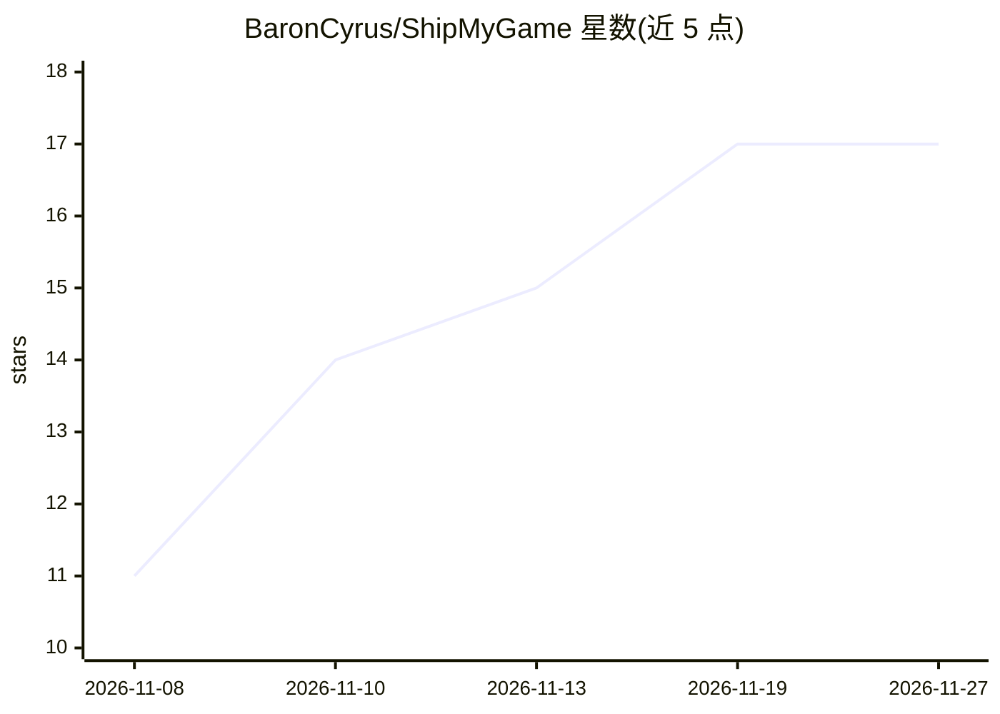

# BaronCyrus/ShipMyGame

⭐ 17 · C# · MIT · 推送 2026-11-23 · [GitHub](https://github.com/BaronCyrus/ShipMyGame) · 个人维护 · 中文 README

**AI Agent 用的 Unity 游戏上架操作手册：一句话完成全渠道发布**

面向 Claude Code、Codex、Cursor 等 Agent 的技能仓库：把 Unity 游戏上架 Google Play、微信小游戏、TapTap 的全流程整理为 Agent 可执行的步骤，覆盖上架前体检、账号注册引导、签名打包与素材制作、后台填报、提审确认与进度记录，并说明各渠道收款方式。步骤来源分 `[实测]` 与 `[官方]` 两级标注；密钥仅存本地，付款实名等操作保留给用户本人。仓库每周自动巡检官方文档变更。

## 筛选速览

| 维度 | 判定 | 备注 |
|---|---|---|
| AI 角色 | `ai-knowledge` | 知识聚合/清单类 |
| 许可风险 | `permissive` | MIT |
| 部署形态 | `library` | 以包/库形式分发 |
| 模型依赖 | — | README 未给出锁定关系 |
| 硬件要求 | — | 无带数字的原话,不猜 |
| 安装摩擦 | `low` | 无编译、无系统依赖或容器化 |
| 成熟度 | — | 结构信号不足 |

## 能力要点

- 覆盖 Google Play / 微信小游戏 / TapTap 三渠道全流程步骤
- 微信小游戏与 TapTap 包体准入测试已有实测通过记录
- 步骤标注 [实测]/[官方] 来源分级
- GitHub Actions 每周巡检官方文档与 SDK 变更

## 适用场景

- 让 AI Agent 从注册账号一路做到提交商店审核
- 上架前体检 Unity 工程（声音、中文乱码、刘海屏遮挡等）
- 跨渠道发布进度用 publish/STATE.md 断点续做

## 场景标签

 · 领域:游戏发布/Agent 技能

## 证据(README 行号)

> L3: **把这个仓库丢给你的 AI Agent，说一句「帮我把游戏发到 TapTap」， 它从注册开发者账号开始，一路做到提交审核。你只需要在浏览器里登录一次。**
> L31: **方式二：装成技能**（Claude Code、Codex、Cursor 等支持 Agent Skills 的工具）
> L64: 2. 读 `skills/ship-my-game/SKILL.md`，从第 1 步开始照做。

## 星数曲线

2026-11-08 11 → 2026-11-27 17（+6）

---
*卡片 v1 · prompt 1.4 · 生成 2026-11-18 · 置信度 high · 依据 README sha `28619be718e6` · [字段定义](../../DATASET.md)*
