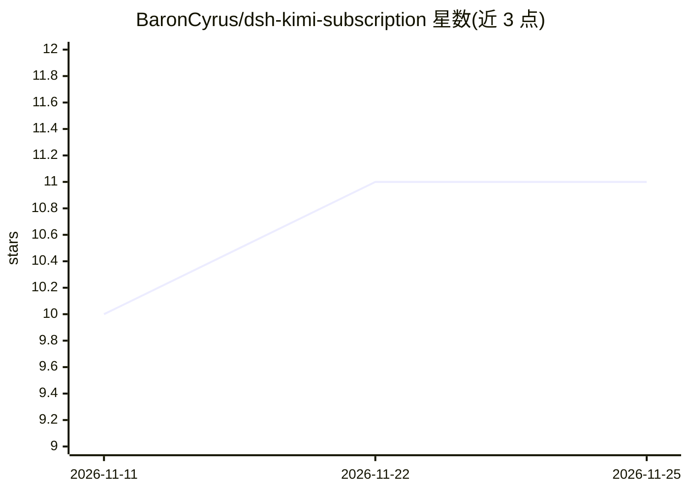

# BaronCyrus/dsh-kimi-subscription

⭐ 11 · JavaScript · MIT · 推送 2026-11-08 · [GitHub](https://github.com/BaronCyrus/dsh-kimi-subscription) · 个人维护 · 中文 README

**DSH 插件：用 Kimi Code 订阅接入 DeepSeek Harness 并查看额度**

DeepSeek Harness（DSH）的社区插件，通过订阅 API Key 或设备登录（OAuth 自动刷新）连接 Kimi Code 订阅，在模型选择器中提供独立的 Kimi subscription 分组，不覆盖已有配置；支持国内站 kimi.com 与国际站 kimi.ai 两种站点、订阅网页搜索接管，并在设置页与输入框显示用量、重置时间与加量包余额。凭据由 DSH Host 管理，不通过浏览器 RPC 返回。需先安装 DeepSeek Harness 与有效的 Kimi Code 订阅。

## 筛选速览

| 维度 | 判定 | 备注 |
|---|---|---|
| AI 角色 | `ai-ecosystem` | LLM/agent 周边工具 |
| 许可风险 | `permissive` | MIT |
| 部署形态 | `library` | 以包/库形式分发 |
| 模型依赖 | — | README 未给出锁定关系 |
| 硬件要求 | — | 无带数字的原话,不猜 |
| 安装摩擦 | `low` | 无编译、无系统依赖或容器化 |
| 成熟度 | — | 结构信号不足 |

## 能力要点

- 订阅 API Key 与 OAuth 设备登录两种连接方式，凭据由 DSH Host 管理
- 独立 Kimi subscription 模型分组，不覆盖已有 kimi-coding 或 Open Platform 配置
- 设置页与输入框展示额度、重置时间与加量包余额
- 支持国内站 kimi.com 与国际站 kimi.ai 站点选择

## 适用场景

- 已有 Kimi Code 订阅，想在 DSH 里直接用订阅模型写代码
- 在 DSH 输入框随时查看订阅额度余量
- 在 DSH 中接管或路由网页搜索到 Kimi 搜索

## 场景标签

`模型网关` · 领域:Agent 开发

## 证据(README 行号)

> L7: **用 Kimi Code 订阅，在 DSH 里写代码、查资料、看额度。**
> L10: 模型选择、网页搜索和额度查询集成在 DeepSeek Harness，无需另配 Open Platform 按量计费密钥。
> L25: |**两种连接方式**|使用 Kimi Code 订阅 API Key，或在设置页发起设备登录；OAuth 支持自动刷新|

## 星数曲线

2026-11-11 10 → 2026-11-25 11（+1）

---
*卡片 v1 · prompt 1.4 · 生成 2026-11-20 · 置信度 high · 依据 README sha `3cd708e41200` · [字段定义](../../DATASET.md)*
